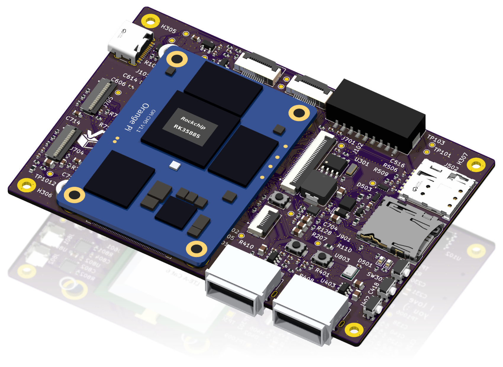
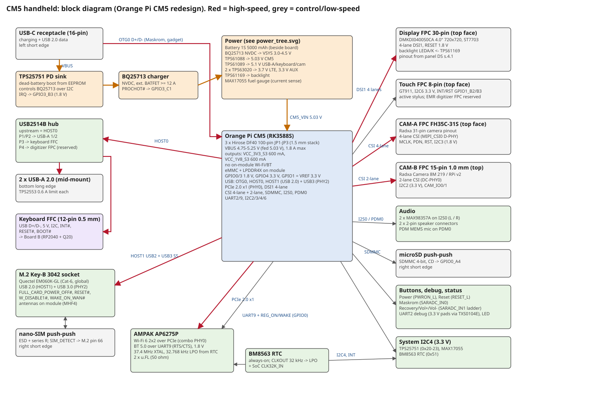
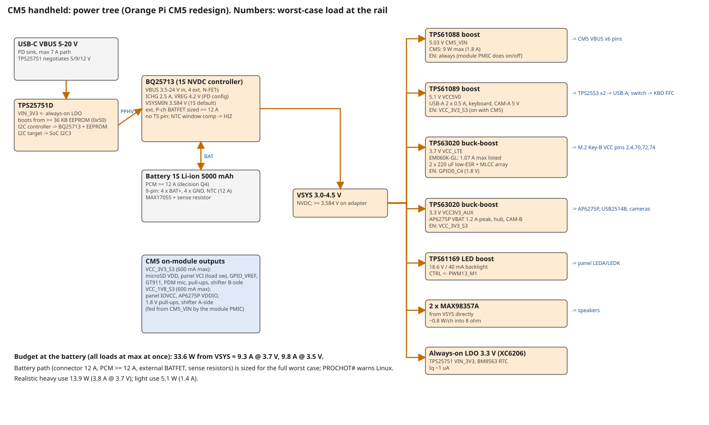
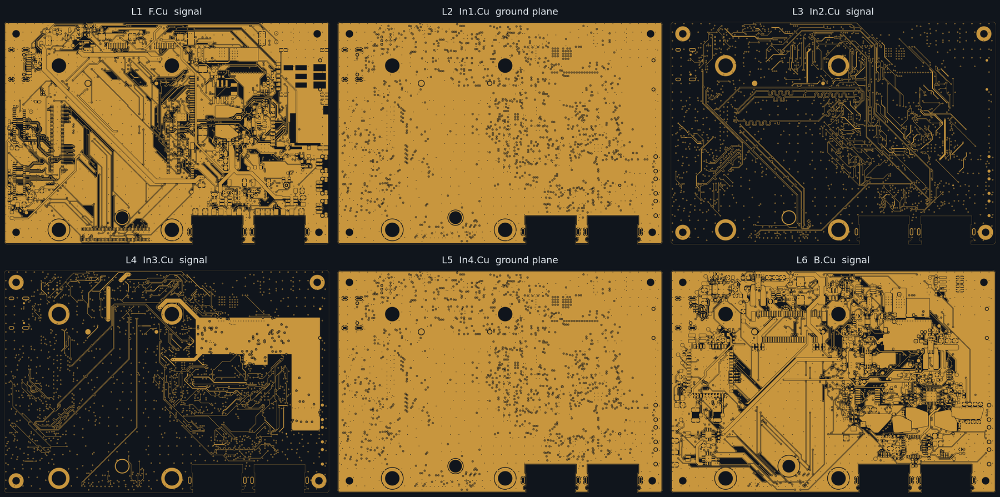
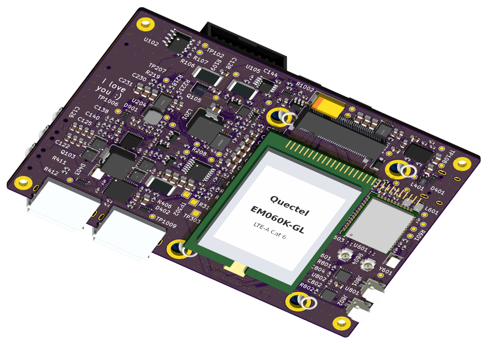
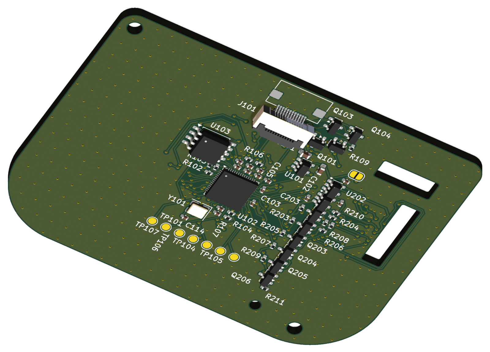

# Quill
A love letter to the classic PDA, but reimagined.

Desktop and phone in one. A clean, all-transparent DORFic design that sits comfortably in your hand. Fully open source, top to bottom. What more could you ask for?
Meet Quill.

  

> **Status, November 2026.** Both boards are designed and pass every check run before manufacture. The main board
> (Board A, rev A) is being made and assembled by JLCPCB, and the compute module has arrived. Nothing has been powered
> on yet: every number on this page is a design value or the result of a check on the design files, not a measurement.

## What Quill is

A pocket computer in the spirit of the classic PDA: a square 4-inch screen above a thumb keyboard, running full desktop
Linux on an eight-core Rockchip RK3588S, with LTE, Wi-Fi 6, two cameras and a 5000 mAh battery. The electronics are two
custom boards: **Board A**, a 6-layer carrier for an Orange Pi CM5 compute module that holds everything except the
keyboard, and **Board B**, which connects a BlackBerry Q20 keyboard over USB.

| | |
|---|---|
| **Compute** | Orange Pi CM5: Rockchip RK3588S (4 x Cortex-A76 + 4 x Cortex-A55), 16 GB LPDDR4X, 32 GB eMMC |
| **Display** | 4.0" 720 x 720 IPS panel (DisplayModule DMKDI0400S0CA, ST7703), 4-lane MIPI DSI, capacitive touch |
| **Keyboard** | BlackBerry Q20 keyboard on Board B (RP2040), USB 2.0 to Board A |
| **Wireless** | Wi-Fi 6 2x2 + Bluetooth 5 (AMPAK AP6275P, PCIe 2.0 + UART); LTE Cat-6 (Quectel EM060K-GL, M.2, USB 3.0); nano-SIM |
| **Cameras** | rear: 4-lane MIPI CSI; front: 2-lane MIPI CSI |
| **Audio** | two I2S class-D amplifiers (MAX98357A) for stereo speakers, PDM MEMS microphone |
| **Ports** | USB-C (USB PD sink up to 12 V, charging and USB 2.0 data), 2 x USB-A behind a USB 2.0 hub, microSD |
| **Power** | 1S Li-ion 5000 mAh; buck-boost charger (BQ25713), fuel gauge (MAX17055), five DC-DC converters; battery path sized for 12 A |
| **Board A** | 95 x 65 mm, 6 layers, 1.2 mm, impedance-controlled; 432 footprints (379 parts placed by machine), 9,637 track segments, 1,841 vias |
| **Board B** | 74 x 53.1 mm, 2 layers, 2.0 mm; 68 parts |

## Architecture

The compute module plugs into Board A through three 100-pin board-to-board connectors (Hirose DF40). High-speed links
are drawn in red: DSI to the display, two CSI links to the cameras, PCIe to the Wi-Fi module, USB 3.0 to the LTE modem,
and USB 2.0 to the hub, the keyboard and the USB-C port.

**Power.** A USB-C PD controller (TPS25751, configured from an EEPROM so that it can boot from a flat battery) negotiates
5, 9 or 12 V and drives a narrow-VDC buck-boost charger. The system rail (VSYS, 3.0-4.5 V) feeds two boost converters
(5.03 V for the compute module, 5.1 V for USB, the keyboard and a camera), two buck-boost converters (3.7 V for the LTE
modem, 3.3 V for Wi-Fi, the hub and the cameras), the backlight driver and the audio amplifiers. With every load at its
maximum at once the battery supplies 33.6 W, 9.8 A at 3.5 V; the connector, protection circuit, battery FET and sense
resistors are all sized for 12 A. Realistic heavy use is about 13.9 W.

## Engineering highlights

### The boards are generated from code

The schematics, footprints, placement and routing are produced by about 16,000 lines of Python and C (`gen/`, `tools/`)
rather than drawn by hand, so every change is reproducible, can be reviewed as a diff, and is checked again on every
build. Board A's routing pipeline (`gen/route_a.py`, about six hours per full run) lays down the power pours and trunks,
routes the differential pairs as coupled lines with their impedance geometry (`gen/route_pairs.py`), fans out every
ground pad, routes the remaining connections with a negotiated-congestion (PathFinder) grid router whose core is written
in C (`gen/groute.c`), and tunes pair lengths with 45-degree bumps (`gen/route_tune.py`). How to run each step:
[docs/BUILDING.md](docs/BUILDING.md).

### Signal integrity on a 6-layer, 1.2 mm board

Layers 2 and 5 are ground planes, so each of the four signal layers has a ground plane next to it as its reference. Trace widths
and gaps come from JLCPCB's impedance calculator for its JLC06121H-3313A stack-up (Polar Si9000 models), and the
outer-layer ground pour keeps 0.30 mm from every controlled trace so that the microstrips behave as calculated:

| Class | Target | Outer layers, width / gap | Inner layers, width / gap | Used for |
|---|---|---|---|---|
| MIPI100 | 100 ohm differential | 0.110 / 0.155 mm | 0.100 / 0.200 mm | display and camera lanes, PCIe reference clocks |
| USB90 | 90 ohm differential | 0.120 / 0.110 mm | 0.100 / 0.110 mm | USB 2.0, USB 3.0 to the modem |
| PCIE85 | 85 ohm differential | 0.130 / 0.100 mm | 0.110 / 0.100 mm | PCIe to the Wi-Fi module |
| SE50 | 50 ohm single-ended | 0.155 mm | 0.125 mm | Wi-Fi antenna feeds, microSD |

Within each of the 31 differential pairs, the two traces match to 0.05 mm or better on 28; the other three are short
stubs, each explained in the decision log. Between lanes, the four display lanes are 55.08-55.22 mm long against a
55.12 mm clock. The camera links are not there yet: two of the rear camera's four lanes are 1.8-2.8 mm (12-20 ps) short
of their clock and the front camera's two lanes 2.8-2.9 mm (20 ps) long, against a +-1.0 mm allowance. Both will be
tested at full lane rate in bring-up ([length report](docs/opi/length_report.md)).

### Verification beyond the design-rule check

KiCad's design-rule check passes with 0 errors and 0 unconnected nets, the schematic and the board match exactly, and
the schematic passes its electrical-rule check. That was not enough, so the project added its own checks:

- **Gerber-level connectivity** (`tools/gerber_check.py`). KiCad treats copper that merely touches as connected; a
  board house's CAM software does not. The exported Gerbers are read back as geometry and every track and via joint is
  measured the way the fab will see it.
- **Comparison with the manufacturer's production files** (`tools/jlc_prod_check/`). JLCPCB's CAM output for the
  order was parsed and compared with our copper layer by layer (geometric XOR), along with track widths, drill counts
  and any copper they added, before the order was confirmed.
- **Footprint audit** ([`docs/footprint_audit.md`](docs/footprint_audit.md)): each of the 24 footprints generated for
  the project checked against its datasheet drawing, down to which edge or centre each dimension line points to.
- **Parts**: every BOM line checked against JLCPCB's live catalogue (part number, manufacturer number, stock), and
  `tools/datasheets.py` confirms that every non-trivial part has its datasheet in [`datasheets/`](datasheets/README.md).

### What went wrong, and what changed because of it

| Date | What happened | Root cause | Response |
|---|---|---|---|
| 2026-10-30 | JLCPCB's CAM stopped the first order: track ends that only touched | KiCad's checks count touching copper as connected | 395 duplicate tracks removed, 153 joints bridged at full width (D110); the Gerber-level checker added (D116) |
| 2026-10-31 | Found in our own review: the outer ground pour ran 0.09 mm from controlled traces | a pour that close makes a microstrip coplanar, lowering its impedance | 0.30 mm keep-out around every controlled trace (D112) |
| 2026-11-06 | JLCPCB's assembly review: the Wi-Fi module's 50 pads sat 0.56 mm too far in | a datasheet dimension measured between pad centres had been read as between pad edges | footprint corrected, board re-routed (D114); every other footprint audited for the same misreading (D115) |
| 2026-11-10 | The display maker's drawing put pin 1 of both panel cables at the other end | the pin direction had been assumed and was marked UNVERIFIED | connectors mirrored and the whole board routed again (D118) |
| 2026-11-15 | JLCPCB: copper too close to the edge rails for V-cut separation | 0.25 mm edge clearance, fine for routed edges, too small for V-cut | rails joined by mouse-bite tabs instead; 0.4 mm clearance for the next revision (D122) |

### Every decision is written down

[`docs/DECISIONS.md`](docs/DECISIONS.md) records 122 design decisions and 22 answered design questions, each with the
choice, the alternatives and the reason, and the sources behind it. Anything not confirmed from a primary source (a
datasheet, a drawing, a measurement) is marked **UNVERIFIED** until it is.

  
  

Left: Board A, bottom side (LTE modem, Wi-Fi module, power stages). Right: Board B, the keyboard board.

## Repository

| Path | Contents |
|---|---|
| [`gen/`](gen/) | generators: schematics, footprints, placement, routing (`route_*.py`, `groute.c`), length tuning |
| [`hw/`](hw/) | the KiCad 10 projects for Board A (`board_a/`) and Board B (`board_b/`), produced by `gen/` |
| [`fab/`](fab/) | the manufacturing packages: Gerbers, drill files, BOM, placement, stack-up, impedance drawing, `ORDER.md` |
| [`tools/`](tools/) | checks and reports: Gerber connectivity, production-file comparison, BOM, impedance, datasheets, images |
| [`docs/`](docs/README.md) | design reports, decision log, review, status, enclosure; index in [`docs/README.md`](docs/README.md) |
| [`datasheets/`](datasheets/README.md) | datasheets, drawings and reference designs the design rests on, with an index |
| [`software/`](software/) | Linux device tree for the Orange Pi images (written, not yet tested on hardware) |
| [`REVIEW.md`](REVIEW.md) | the pre-manufacture review: open points, assumptions, what an experienced engineer should check |

## Roadmap

- [x] Requirements, architecture, pin and power budgets
- [x] Schematics, placement, routing and manufacturing files for both boards
- [x] Board A redesigned for the Orange Pi CM5 when the original compute module (Radxa CM5) could not be bought
- [x] Board A rev A ordered: 6 layers, impedance-controlled, assembled by JLCPCB
- [ ] Bring-up: power rails, USB PD and charger configuration, first boot, display, cameras, Wi-Fi, LTE
- [ ] Measurements: converter efficiency, battery life, thermals, signal quality on the high-speed links
- [ ] Linux device tree and drivers validated on the hardware
- [ ] Enclosure: a transparent swivel case (concept in [`docs/enclosure/`](docs/enclosure/))
- [ ] Rev B with what bring-up teaches
- [ ] A write-up of the whole project as a paper

## How Quill is made

Quill is designed by Rak Pozareny with Claude, an AI model made by Anthropic, used through Claude Code. Rak defined the
device and its requirements, made the calls at each decision point, sourced the modules and parts, and handles the
manufacturers and suppliers; the hardware will be assembled and tested by hand. Claude wrote the generator and checking
code, produced the schematics and layout with it, and wrote most of the documentation. Commits made with Claude carry a
`Co-Authored-By: Claude` line.

## Licences

Everything here is under the MIT licence ([`LICENSE`](LICENSE)), except:

- **Board B** (`hw/board_b/`, `fab/board_b/`, and `gen/build_b.py`, `gen/pcb_b.py`, `gen/route_b.py`, which build it):
  its keyboard connector placement and outline are derived from Solder Party's
  [BBQ20KBD](https://github.com/solderparty/bbq20kbd_hw), so it is released under the CERN Open Hardware Licence v1.2
  ([`hw/board_b/LICENSE.md`](hw/board_b/LICENSE.md)). The recommended firmware,
  [i2c_puppet](https://github.com/solderparty/i2c_puppet), is MIT-licensed.
- **[`datasheets/`](datasheets/README.md)**: other companies' documents (datasheets, drawings, reference schematics),
  copyright their makers, kept here for reference and not covered by the MIT licence. The BBQ20KBD files there are
  CERN-OHL v1.2 (licence beside them).

## Acknowledgements

Solder Party's BBQ20KBD and i2c_puppet, which Board B and its firmware build on; Orange Pi, Radxa and Khadas, whose
published schematics and drawings served as reference designs; and the open-source KiCad project.

The renders use the parts' 3D models from the **JLCEDA / EasyEDA Official Library** ([lceda.cn](https://lceda.cn/),
[easyeda.com](https://easyeda.com)), fitted onto this design's footprints by `tools/media.py`; the compute module, the
LTE card, the USB-A ports and the battery connector are modelled from their drawings and a photo of the module.
