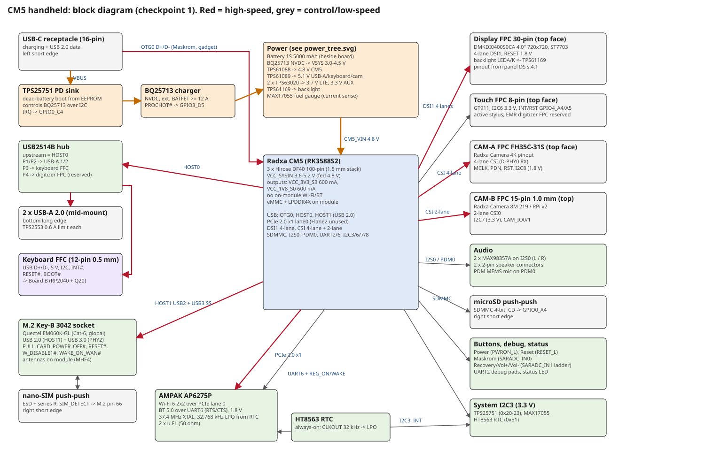
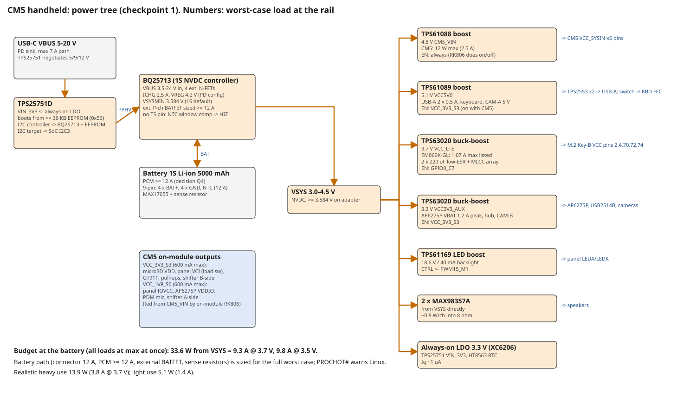

# Checkpoint 1: research summary, block diagram, pin budget, power

Project: Radxa CM5 handheld carrier (Board A) + BlackBerry Q20 keyboard board (Board B)
Date: 2026-10-14 · Status: **checkpoint 1 complete; all questions answered (section 11, `docs/DECISIONS.md`); ready for checkpoint 2 (schematics)**

Revised after your answers: the charger is now a **BQ25713** controlled by a **TPS25751**, the fuel gauge is a **MAX17055**, the battery path is sized for **12 A** (9-pin connector, ≥12 A PCM), the modem also gets **USB 3.0**, and the stylus approach is fixed.

Everything below is traceable to a downloaded document (section 12). Anything I could not confirm from a source is marked **UNVERIFIED** and collected in section 10.

---

## 0. Summary

**Settled by the research:**
- **CM5:** RK3588S2 on 3 × Hirose DF40C-100DP-0.4V plugs. Carrier side is 3 × DF40C-100DS-0.4V(51) (1.5 mm mated height), the same part Radxa's IO board uses. LCSC C597931, 33.5 k in stock.
- **CM5 supply:** VCC_SYSIN is **3.6–5.2 V** (Radxa recommends a 4 V / 3 A supply).
- **No Wi-Fi/BT on the CM5.** That needs an on-board module; AP6275P is proposed.
- **USB:** the CM5 exposes only **two USB 2.0 host ports** plus OTG0, so a hub is needed. HOST0 goes to the hub (2 × USB-A, keyboard, spare); HOST1 goes directly to the LTE modem.
- **Display/cameras:** DSI1 is the only 4-lane DSI. CSI is 4-lane + 2-lane, so the cameras are one 4-lane (Radxa Camera 4K pinout) and one 2-lane (Radxa Camera 8M / RPi v2 pinout), exactly as on Radxa's IO board.
- **Keyboard:** the Q20 flex carries the key matrix, the 4 top buttons, the optical trackpad (1.8 V I2C), the key backlight LEDs and a microphone. Board B can support all of it with the BBQ20KBD pin map, so the i2c_puppet firmware (MIT) runs unmodified.

**Changes forced by the research (I deviated from the brief):**
1. **CM5 supply rail.** A direct VSYS feed would brown out the CM5 below about 3.6 V. The candidate 4.0 V buck-boost (TPS55288) powers up with its output *disabled* until an I2C write, so nothing could turn it on before the CM5 boots. No standalone buck-boost of 5 A or more is stocked. Plan: a **TPS61088 boost to 4.8 V**. VSYS never exceeds 4.55 V, so it always regulates, and 4.8 V sits inside the CM5's 3.6–5.2 V range. The trade-off is that it's above Radxa's preferred 4 V (section 5.1).
2. **Worst-case battery current is 9.3 A at 3.7 V (9.8 A at 3.5 V), not about 5 A.** The original BQ25792 charger can pass only 6 A RMS from the battery. Per your answer (Q2) it is replaced by a **BQ25713** controller with an external battery FET, and the whole battery path is sized for 12 A.
5. **The BQ25713 has no battery-thermistor (TS) input**, so your brief's "NTC to the charger's TS pin" can't be done literally. Replacement: a hardware window comparator on the pack NTC forces the charger into its no-charge state outside 0–45 °C. It works with the SoC off.
3. **Wi-Fi/BT module lines need a 1.8 V bank.** The AP6275P's I/O rail is 1.8 V only. Its BT UART and enables use the CM5's 1.8 V S3 banks; the PCIe sideband signals go through a 3.3 ↔ 1.8 V translator.
4. **No nano-SIM + microSD combo tray is stocked at JLCPCB.** I'll use two push-push sockets on the right edge, which is your stated fallback.

**Decisions:** all 13 questions plus two follow-ups are answered; see section 11 and `docs/DECISIONS.md`.

---

## 1. Your answers and how I applied them

| Question | Your answer | Applied as |
|---|---|---|
| Display | Default 4″ 720×720 + "high quality stylus" | Default panel proposed: **DisplayModule DMKDI0400S0CA** (4.0″ 720×720, ST7703, 4-lane DSI, GT911 capacitive touch). A *high-quality* stylus isn't something capacitive touch provides, so the stylus is open question **Q1** with four options. |
| Battery | 8×65×85 mm, **beside** the board | Board bottom side is free for components (the M.2 LTE module goes under the CM5). Enclosure impact in section 5.12. |
| LTE | "Implement it on the board itself, not through a connector such as USB-A; use **EM060K-GL**" | EM060K-GL exists only as an M.2 3042 card, so it can't be soldered down. Plan: M.2 Key-B socket **on the carrier**, wired straight to its own SoC USB port (HOST1, no hub, no USB-A). For a soldered-down module, see **Q6**. |
| Fab / USB-C | Keep defaults | JLCPCB 6-layer, impedance-controlled, 1.2 mm (section 5.10). USB-C is a 16-pin USB 2.0 receptacle with no DP alt-mode. |

The second round of answers (Q1–Q13) is in section 11.

---

## 2. Reference material status

| Source | Status |
|---|---|
| Radxa CM5 docs (docs.radxa.com renders only with JavaScript, so I used the docs' GitHub source `radxa-docs/docs`) | ✅ README, hardware interface, revisions, downloads, FAQ, accessories |
| Radxa CM5 V2.21 pinout (xlsx), V2.21 schematic, 2D DXF, 3D STEP, placement map | ✅ downloaded and parsed |
| Radxa CM5 IO board V2.2 schematic, BOM, 2D DXF, PADS/Altium layout (`radxa/radxa-cm-projects`) | ✅ schematic + BOM + DXF parsed; layout files fetched for checkpoint 2 |
| Solder Party BBQ20KBD hardware (`solderparty/bbq20kbd_hw`, KiCad) + i2c_puppet firmware | ✅ cloned, schematic and PCB parsed |
| TI TPS25750, TPS25751, BQ25792, BQ25713, BQ25731, TPS55288, TPS61088, TPS63020, TPS61169 datasheets | ✅ |
| Quectel EM060K Series & EM120K-GL Hardware Design V1.1 (from quectel.com) | ✅ |
| DisplayModule DMKDI0400S0CA specification V1.0 | ✅ (outline drawing is a low-resolution image, so the FPC pitch is UNVERIFIED) |
| AMPAK AP6275P datasheet | ✅ |
| MAX98357A datasheet (analog.com unreachable from this machine; Adafruit mirror used) | ✅ |
| MAX17048/MAX17049 datasheet, Rev 1 (4/12), copy you supplied (alldatasheet.com mirror) | ✅ (MAX17048 since replaced by MAX17055, decision Q13) |
| **MAX17055 datasheet** | ❌ analog.com times out and both LCSC copies are "temporarily unavailable". Needed before the schematic. |
| Molex Micro-Lock Plus 505575 drawing (LCSC) | ✅ (electrical ratings are in a separate product spec, 5055700001-PS, not obtained) |
| USB2514B, DF40 datasheets | ✅ downloaded, to be read at checkpoint 2 |
| JLCPCB capabilities + 6-layer stack-ups (via JLCPCB's impedance-calculator API) | ✅ |
| LCSC/JLCPCB stock (via JLCPCB's parts API, 14 Oct 2026) | ✅ |

---

## 3. Radxa CM5: verified facts

| Item | Value | Source |
|---|---|---|
| SoC | RK3588S2 | DOC README |
| Module outline | **41.0 × 56.0 mm in Radxa's DXF**, with R4 corners concentric with the holes. Docs say "55 × 40 mm". I'll use the DXF size as the keep-out. **UNVERIFIED which is right.** | CM5 2D DXF (BOARD_OUTLINE layer); DOC README |
| Mounting holes | 4 × Ø2.6 mm drill (Ø3.0 mm pad), on a **33.0 × 47.95 mm** rectangle (same spacing as RPi CM4), 4.0 mm from the DXF edges | CM5 DXF (TOOL_BOT), IO board DXF |
| B2B connectors | 3 × 100-pin Hirose DF40, 0.4 mm. Module: DF40C-100DP-0.4V. Carrier: **DF40C-100DS-0.4V(51)**, mated height **1.5 mm**, rated 0.3 A per contact | CM5 sch p4; IO BOM; LCSC C597931 |
| Connector positions (from module centre = hole-pattern centre, carrier top view) | A (pins 1–100): (+17.03, +2.49) mm, vertical. B (101–200): (−17.03, +2.49) mm, vertical. C/"J1" (1–100): (+0.07, +24.0) mm, horizontal. Module and IO-board DXFs agree within 0.06 mm. | CM5 + IO DXF pad clusters |
| Supply | VCC_SYSIN on 6 pins (A77–A87), **3.6–5.2 V**, "maximum efficiency achieved at 4V. Supplying 5V or above may cause audible humming from the voltage regulating circuit." Typical 2 A; recommended supply 4 V / 3 A. The IO board makes 4.04 V with an MP8759 buck. | DOC README; IO sch p15 |
| Outputs for the carrier | VCC_3V3_S3 (A84, A86, C92), **600 mA max**. VCC_1V8_S0 (A88, A90), **600 mA max**. VCCIO_FLASH (A73) = VCC_1V8_S3. | Pinout xlsx; CM5 sch p4 |
| 5V_HDMI (B106) | Must be 5 V only if HDMI is used and VCC_SYSIN < 5 V; it feeds the HDMI DDC level shifter. No HDMI here, so NC. | Pinout xlsx note; CM5 sch p4 |
| GPIO_VREF (A78) | Tied on-module to VCC_3V3_S3 (sets VCCIO6 = 3.3 V); the IO board leaves it NC | CM5 sch p4, p17 |
| I/O voltage banks | PMUIO1 1.8 V; PMUIO2 3.3 V; VCCIO1 **1.8 V only** (S0 rail, off in suspend); VCCIO4 1.8 V (S3); VCCIO5 3.3 V; VCCIO6 3.3 V | CM5 sch p9, p13, p17 |
| Power-on | PWRON_L → RK806 PWRON (button to GND). RK806 auto-boots when VCC_SYSIN appears (VDC divider). | CM5 sch p18 |
| Reset / Maskrom / Recovery | RESET_L (A92) → NPOR; SARADC_IN0 (A93) to GND = Maskrom (the module also has its own button); SARADC_IN1 (C26) to GND = Recovery | CM5 sch p13; IO sch p19 |
| USB exposed | OTG0 USB2 (B101–105) + OTG0 USB3/DP lanes (C3–C29); **USB2 HOST0** (C63/65); **USB2 HOST1** (C45/47); USB3 SuperSpeed on combo PHY2 (C51–59, shared with PCIe/SATA) | Pinout xlsx |
| PCIe | PCIe 2.0 x1 lane 0 (B110–124) with PCIE20X1_2 sidebands; lane 2 on combo PHY2 (C39–59) | Pinout xlsx; IO sch p7 |
| MIPI | DSI0 2-lane (B157–171), **DSI1 4-lane** (B175–196), CSI D/C-PHY0 RX 4-lane (B115–141), CSI0 2-lane (B128–142) | Pinout xlsx; DOC FAQ |
| SDMMC | 4-bit on A57–A69, detect C74, SD_PWR_ON A75 | Pinout xlsx; IO sch p6 |
| Audio | I2S0 pins (1.8 V); no on-module codec ("external codec needed") | Pinout xlsx; DOC FAQ |
| Wireless | **None on the module** ("there is no on-board WiFi/BT module, external module is required") | DOC accessories/wifi_bt_access |
| Ethernet | On-module GbE PHY, MDI on A3–A12 (unused here) | Pinout xlsx |

---

## 4. BBQ20KBD (Board B reference): verified facts

| Item | Value | Source |
|---|---|---|
| License | **CERN-OHL v1.2** (hardware); firmware i2c_puppet **MIT** | repo LICENSE files |
| Keyboard mating connector | **Hirose BM20B(0.8)-40DS-0.4V(51)**, 40 pins, 0.4 mm, 0.8 mm stack. LCSC C424543, 8.8 k in stock. | bbq20_keyboard.kicad_pcb (footprint + LCSC field) |
| Keyboard pinout | 1 GND, 2 TP_SHUTDOWN, 3 TP_SCL, 4 TP_MOTION, 5 TP_SDA, 6 TP_RESET, 7/9/11 GND, 8 +2V8, 10 +1V8, 12–18 COL1–COL7, 19–22 GND/AGND, 23 MIC, 24 MIC_VDD, 25 GND, 26–32 ROW7–ROW1, 33/35/37 LEDK, 34/36 LEDA, 38/39 NC, 40 GND | same (pad nets) |
| Matrix | 7 rows × 6 columns on GPIO1–7 / GPIO8,9,14,13,12,11; trackpad click and BTN_LEFT1/LEFT2/RIGHT1 in the matrix; **BTN_RIGHT2 on COL7 (GPIO10, doubles as BOOTSEL)**. All 4 top buttons + trackpad are supported. | schematics.pdf; i2c_puppet boards/bbq20kbd_breakout.h, app/keyboard.c |
| Trackpad | Optical, on the keyboard flex, I2C at 1.8 V (address 0x3B), needs +1V8 and +2V8; BSS138 level shifters to the 3.3 V RP2040 | schematics.pdf p2; i2c_puppet app/touchpad.c |
| Backlight | LEDs are on the keyboard flex (LEDA = 3.3 V, LEDK switched by a BSS138 driven from RP2040 GPIO25 = PWM4B), so it is PWM-dimmable | schematics.pdf |
| MCU | RP2040 + 16 Mbit QSPI flash, 12 MHz crystal, AP2112K-3.3 from 5 V | schematics.pdf p1 |
| Board size | 74.0 × 53.1 mm (Edge.Cuts), including USB-C, PMOD and Qwiic, which Board B won't need | kicad_pcb |

---

## 5. Architecture decisions

### 5.1 Power

See `power_tree.svg` and section 7.

- **USB-C PD sink: TPS25751D** (WQFN-38, integrated sink path). LCSC C30169739, 5.7 k in stock.
  - **Why the TPS25751 instead of the TPS25750:** its datasheet explicitly lists integrated I2C control of the BQ25713 (along with BQ25731, BQ25792 and others). The TPS25750 datasheet names no supported chargers, and its BQ25713 support rests only on a TI forum reply. It is also USB-IF PD 3.1 certified.
  - **EEPROM boot:** patch + configuration come from an I2C **EEPROM of at least 36 KB at 0x50** on its controller bus, so PD and charging work with a dead battery and the SoC off. It is programmed through on-board pads (decision Q12).
  - **Dead-battery strap:** SafeMode (no sink path until the configuration is loaded).
  - **SoC link:** the SoC talks only to the TPS25751 (I2C target at 0x20–0x23 via ADCIN straps, IRQ → GPIO0_C4).
  - **Linux:** mainline `tipd` lists only `ti,tps25750`, so TPS25751 support is **UNVERIFIED**. It isn't needed for charging.
  - **VIN_3V3:** from an always-on 1 µA-Iq LDO.
- **Charger: BQ25713** (NVDC buck-boost charge controller, I2C 0x6B). LCSC C2878935, 3.3 k in stock.
  - **Range:** 3.5–24 V input, 1–4 cells, set to 1S by the CELL_BATPRESZ divider. 1S defaults: VREG 4.2 V, VSYSMIN 3.584 V, SYSOVP 5 V.
  - **Battery-less operation:** "Instant-on with no battery or depleted battery" (datasheet), so the system runs with no battery fitted, as your brief requires.
  - **External parts:** 4 N-channel switching MOSFETs, a P-channel battery FET, input and battery current-sense resistors, and the inductor. The battery FET runs in linear mode at VSYSMIN when the battery is flat, as an ideal diode in supplement mode, and fully on otherwise.
  - **Battery FET sizing:** ≥12 A. Constraint: BATDRV drives at most 5 nF of gate capacitance (1–3 nF recommended), which limits the FET choice (checkpoint 2).
  - **Charge settings:** 2.5 A / 4.2 V and the input limits are written by the TPS25751 configuration. Which fields TI's web tool exposes is **UNVERIFIED**.
  - **VSYS max:** battery + 160 mV (±3 %), about 4.36–4.5 V, so the 4.8 V CM5 boost below still always regulates.
  - **No battery-thermistor input.** A window comparator on the pack NTC (trips below 0 °C or above 45 °C) pulls ILIM_HIZ low, which puts the charger in HIZ: no charging, system on battery. It works with the SoC off. Thresholds are set at checkpoint 2, once the pack's NTC type is known.
  - **PROCHOT#** (open drain) → GPIO3_D5. It asserts on battery-discharge current above a programmable threshold, low VSYS and input over-current, so Linux can throttle the CPU/GPU before the battery path is stressed.
- **Battery path, sized for 12 A** (decisions Q3/Q4):
  - 9-pin Molex Micro-Lock Plus 2.0 mm (4 × BAT+, 4 × GND, NTC; 12 A at 3.0 A per contact).
  - Pack PCM ≥12 A.
  - Battery FET, both current-sense resistors and copper all rated for 12 A.
- **CM5 rail: TPS61088 boost → 4.8 V**, always on whenever VSYS exists; the RK806 handles on/off via the power button. Why not the brief's options:
  - **Direct VSYS:** on battery, VSYS follows VBAT (3.0–4.2 V minus I·R), so the CM5 (min 3.6 V) would brown out with 10–40 % charge left, depending on load.
  - **4.0 V buck-boost:** TPS55288 needs I2C to enable its output (OE bit resets to 0). Other parts are too small: TPS63020 has a 4 A switch, about 2 A out in boost mode, below the 3 A the CM5 wants. No ≥5 A standalone buck-boost is in JLCPCB stock.
  - **Boost:** VSYS max is about 4.5 V (BQ25713: battery + 160 mV ±3 %), so a 4.8 V output always regulates and stays 0.4 V below the CM5's 5.2 V max.
  - **Cost:** slightly lower RK806 efficiency than at 4 V (my estimate: 2–3 %), and Radxa's "≥5 V may hum" note sits 0.2 V above our rail.
- **5 V rail: TPS61089 boost → 5.1 V** for 2 × USB-A, the keyboard board and CAM-A's 5 V pins.
  - Enabled by GPIO0_C2 with a default-on pull-up.
  - Per-port TPS2553 current limits (~0.6 A) are switched by the USB2514B port-power pins.
- **LTE rail: TPS63020 buck-boost → 3.7 V** (EM060K-GL range is 3.135–4.4 V; a direct VSYS feed could exceed 4.4 V when charging is done).
  - Datasheet max data-transfer draw is 1.07 A. **Quectel's generic PSU guideline is 3 A continuous / 4 A peak; the TPS63020 meets that only in buck mode.** In boost mode it gives about 2 A plus 2 × 220 µF bulk capacitance. Listed as a risk, not hidden.
- **AUX 3.3 V: second TPS63020** for the AP6275P (1.2 A peak), USB hub and cameras.
- **Backlight: TPS61169** LED boost (18.6 V × 40 mA, PWM on CTRL).
- **Fuel gauge: MAX17055** (TDFN-10; decision Q13). LCSC C2976422 (MAX17055ETB+T), 6.1 k in stock.
  - It uses a current-sense resistor in the battery path. The mainline `max17042_battery` driver reports battery current, average current and a charge counter from it (checked in the driver source).
  - **Datasheet not obtained yet**, so its pin-out, sense-resistor value and placement, I2C address and thermistor options are **UNVERIFIED**. If you can drop it in your home directory like the MAX17048, I'll fold it in before the schematic.
  - ALRT# → GPIO0_D3 (wake-capable).
- **CM5 outputs are kept light:** VCC_3V3_S3 ≤ 300 mA of its 600 mA (SD card, panel VCI, touch, pull-ups); VCC_1V8_S0 ≤ 100 mA.

### 5.2 USB topology

The CM5 has OTG0 + HOST0 + HOST1 (USB 2.0). The devices needing a host port are USB-A ×2, the keyboard and LTE, which is more than two, so **a hub is required**.

- **OTG0 → USB-C:** device by default; this is the Maskrom/download port. 2.2 Ω series, common-mode choke and ESD, as on the IO board.
- **HOST1 → M.2 LTE directly:** this is the USB 2.0 half of the modem's USB 3.0 link (section 5.3). Full bandwidth, and the modem's power management isn't tied to the hub.
- **HOST0 → USB2514B:** P1/P2 USB-A, P3 keyboard FFC, P4 reserved digitizer FPC (decision Q1).
- **Why USB2514B over Radxa's FE1.1S:** multi-TT and per-port power control. Both are stocked.

### 5.3 LTE

- **Socket and USB:** M.2 Key-B 3042 socket on the board's **bottom side under the CM5**.
  - **USB 2.0 + USB 3.0** (decision Q7): USB 2.0 from HOST1 → M.2 pins 7/9. SuperSpeed from combo PHY2: host TX (J1-51/53) → 100 nF → M.2 pins 37/35; module TX (M.2 pins 31/29) → host RX (J1-57/59) with no caps, since those are inside the module (Quectel Fig. 18).
  - This is the same pairing Radxa's IO board uses for its USB 3.0 port. The M.2 PCIe pins stay unconnected.
- **Control signals** (levels from the EM060K Hardware Design V1.1):
  - FULL_CARD_POWER_OFF# is 3.3 V tolerant (on above 1.19 V), so it's driven directly from GPIO0_D0.
  - RESET# and W_DISABLE1# have internal pull-ups, so they're driven open-drain through NMOS (Quectel reference).
  - WAKE_ON_WAN# (OD) → GPIO0_C6.
- **SIM:** nano-SIM push-push socket with ESD and series parts per Quectel's reference (values at checkpoint 2); SIM_DETECT → USIM1_DET (M.2 pin 66).
- **Antennas:** main and diversity/GNSS go to the module's own connectors.
- **eSIM:** possible (an MFF2 eSIM in parallel with the socket is a common design), but Quectel's dual-SIM/eSIM wiring isn't verified yet; I'd treat it as a footprint option at checkpoint 2.

### 5.4 Wi-Fi / Bluetooth

**AMPAK AP6275P** (BCM43752, Wi-Fi 6 2×2 over PCIe 2.0 lane 0, BT 5.0 over UART + PCM), LCSC C2984107, 494 in stock.

- **Why this module:** the CM5 exposes no SDIO, so SDIO modules are out, and a PCIe module needs no hub port. Radxa's IO board uses the same PCIe lane for its Wi-Fi.
- **BT UART:** UART6_M1 with RTS/CTS on the four pins Radxa labels "…_WIFI" (1.8 V).
- **Enables and wakes:** WL_REG_ON / BT_REG_ON / BT_WAKE on VCCIO4 (1.8 V S3, so the radio survives suspend); WL/BT_HOST_WAKE on PMU GPIO0_A0 / GPIO0_B0.
- **PCIe sidebands:** PERST#, CLKREQ#, PME# through a 4-channel translator (Radxa uses UM3204).
- **Supporting parts:** 37.4 MHz crystal; 32.768 kHz LPO from an always-on HT8563 RTC (the same approach as the IO board, which also gives the device a battery-backed clock); 2 × u.FL on 50 Ω coplanar lines.
- **Driver support:** mainline `brcmfmac` supports BCM43752 over PCIe (checked in the 7.3-rc7 source; needs firmware `brcmfmac43752-pcie`). **Radxa BSP support is UNVERIFIED:** Radxa ships a `broadcom-wifibt-firmware` package, but I haven't confirmed it covers the AP6275P.
- **BT audio:** BT PCM is routed to test pads only, because SCO over HCI needs no I2S.

### 5.5 Display, touch, stylus

- **Panel (proposed): DMKDI0400S0CA.** 30-pin display FPC:
  - 4-lane DSI on pins 7–20.
  - RESET (26) at IOVCC = 1.8 V, driven by LCD_RESET_L (1.8 V) directly.
  - IOVCC 1.8 V from VCC_1V8_S0; VCI 3.3 V through a load switch on LCD_PWREN_H.
  - TE (25) left NC.
  - Backlight: 12 LEDs at 18.6 V / 40 mA via TPS61169.
- **Touch:** a separate 8-pin CTP tail (GT911, I2C at 3.3 V on I2C6, INT/RST on 3.3 V GPIOs, so no translator). This is a **second FPC connector** beyond the one the brief listed.
- **Linux:** needs a panel entry for `panel-sitronix-st7703` with this panel's init sequence, which must come from the vendor (software risk).
- **Stylus (decision Q1):** capacitive touch with a universal active stylus now. A reserved "digitizer" FPC (USB from hub port 4, I2C, INT, RST, 3.3 V, GND) leaves room for an EMR pen digitizer later without a respin.

### 5.6 Cameras

Same as Radxa's IO board, so the official camera modules plug in.

- **CAM-A:** 4-lane CSI (D/C-PHY0 RX) on a Hirose FH35C-31S-0.3SHW(50) (Radxa Camera 4K, IMX415 pinout). MCLK GPIO1_B6, PDN, RST and I2C8 at 1.8 V, plus 3.3 V and 5 V.
- **CAM-B:** 2-lane CSI0 on a 15-pin 1.0 mm FPC (Radxa Camera 8M 219 / RPi v2 pinout, Radxa's "reverse" pin order). I2C7 at 3.3 V and CAM_IO0/1.
- **Lane split 4 + 2:** CAM-B is limited to 2 lanes, which is still enough for 8 MP @ 30 fps on an IMX219.
- **Low-profile requirement:** I still need a horizontal flip-lock 15-pin 1.0 mm connector; the IO board's part is vertical (3 mm), and JLCPCB search found no stocked horizontal one yet. This goes to checkpoint 2.

### 5.7 Audio

- **Amps:** 2 × MAX98357A on I2S0 (1.8 V; VIH 1.3 V so compatible; no MCLK), powered from VSYS. One 3.3 V GPIO drives both SD_MODE pins: left amp through ~2 kΩ, right amp through 210 kΩ (datasheet Table 6).
- **Speakers:** 2 × 2-pin JST-SH.
- **Microphone:** a PDM MEMS mic on PDM0_M0 (1.8 V). The keyboard flex also has a mic; it stays unused, as on BBQ20KBD.

### 5.8 Storage

microSD push-push socket on SDMMC: 22 Ω on CLK, ESD on all lines, card-detect to GPIO0_A4 with a 100 kΩ pull-up to VCCIO_FLASH, and an optional SD power P-FET on SD_PWR_ON with a 0 Ω bypass (as on the IO board).

### 5.9 Keyboard interface (draft FFC, identical on both boards)

| FFC pin | Signal | Carrier side | Board B side |
|---|---|---|---|
| 1 | GND | | |
| 2 | +5V_KBD | VCC5V0 via switch | AP2112K-3.3 input |
| 3 | +5V_KBD | | |
| 4 | GND | (guard next to D−) | |
| 5 | USB_D− | hub P3 | RP2040 USB_DM (27 Ω) |
| 6 | USB_D+ | hub P3 | RP2040 USB_DP (27 Ω) |
| 7 | GND | (guard next to D+) | |
| 8 | KBD_SDA | I2C6 (3.3 V) | RP2040 GPIO28 |
| 9 | KBD_SCL | I2C6 | RP2040 GPIO29 |
| 10 | KBD_INT# | GPIO0_D5 (PMU domain, can wake the SoC) | RP2040 GPIO0 (OD) |
| 11 | KBD_RESET# | GPIO4_A7 (OD) | RP2040 RUN (10 kΩ pull-up) |
| 12 | KBD_BOOT# | GPIO4_B5 (OD) | RP2040 QSPI_SS via 1 kΩ (BOOTSEL) |

- **Cable and connectors:** 0.5 mm pitch, 12 conductors. Connector: BXCONN FC-05A12P11H20 (bottom contact, flip-lock, C23398836) on both boards. Cable length and same-side vs opposite-side contacts are decided at checkpoint 3 from the placement.
- **Firmware:** i2c_puppet, board `bbq20kbd_breakout`. It can be flashed from Linux by holding BOOT# during RESET# (the RP2040 then appears as a USB drive). SWD pads on Board B as a fallback.
- **Voltage levels:** the RK3588S lines used are all on 3.3 V banks, so no translation is needed.

### 5.10 PCB stack-up and fab rules

- **Stack-up: JLCPCB JLC06121H-3313A**, 6 layers, **1.2 mm**, NP-155F, 1 oz outer / 0.5 oz inner (template data from JLCPCB's impedance-calculator API):
  `L1 Cu 35 µm | PP 3313 99.4 µm εr 4.1 | L2 | core 100 µm εr 4.36 | L3 | 3 × PP 7628 ≈ 639 µm εr 4.4 | L4 | core 100 µm | L5 | PP 3313 99.4 µm | L6`
- **Layer use:** SIG / GND / SIG / SIG / GND / SIG. Every routing layer is about 0.1 mm from a solid ground plane, and the two inner signal layers are 0.64 mm apart (low crosstalk).
- **Impedances** (90 Ω USB, 100 Ω MIPI, 85/100 Ω PCIe, 50 Ω RF) will be computed with JLCPCB's own calculator at checkpoint 2 and turned into KiCad net classes.
- **JLCPCB 6-layer rules** (capabilities page):
  - Track/space 0.09/0.09 mm (1 oz).
  - Via 0.15 mm drill / 0.25 mm pad (0.2 mm drill preferred).
  - Via-in-pad, plated over filled, is free and the default on 6-layer.
  - No HASL on 6-layer; ENIG is available.
  - Impedance tolerance ±10 %.
  - Board thickness 0.4–2.0 mm for FR-4.

### 5.11 Linux driver check (mainline 7.3-rc7 source)

| Device | Mainline driver | Status |
|---|---|---|
| TPS25751 PD controller | `drivers/usb/typec/tipd/core.c` | only `ti,tps25750` is listed; TPS25751 **UNVERIFIED** (not needed for charging) |
| MAX17055 fuel gauge | `max17042_battery.c` | present (current, average current, charge counter) |
| ST7703 panel | `panel-sitronix-st7703.c` | present; **this panel needs a new init descriptor** |
| GT911 touch | `goodix.c` | present |
| MAX98357A amp | `max98357a.c` | present |
| HT8563 RTC (PCF8563-class) | `rtc-pcf8563.c` | present; HT8563 register compatibility **UNVERIFIED** |
| AP6275P (BCM43752 PCIe) | `brcmfmac` | present |
| USB2514B hub | `usb251xb.c` (optional, only for SMBus config) | present |
| BQ25713 charger | none needed (owned by the TPS25751) | n/a |

### 5.12 Early mechanical feasibility (preliminary, refined at checkpoint 3)

- **Area:** estimated component area is about 6,100 mm² across both sides, against 2 × 6,175 mm² at 95 × 65 mm. That looks feasible with double-sided assembly. Routing density around the 300 DF40 contacts is the limiting factor.
- **Height:** the CM5 stack is 1.5 mm plus module PCB and components (module height **UNVERIFIED**, to be measured from Radxa's STEP), so probably about 4 mm above the board. Under the board, the M.2 module plus socket adds about 3–4.5 mm depending on socket height. Expect **about 8.5–9.5 mm** assembled; you accepted about 9 mm (Q11).
- **Enclosure with the battery beside the board:** board (95 × 65) and battery (85 × 65) stacked along the device length gives roughly 95 × 135 mm behind the display (84 × 86 mm module) plus keyboard. The front face is about 95 × 150 mm and the depth about 15 mm (board ~9 + display 3.8 + walls). With the battery *under* the board instead, the footprint shrinks to about 95 × 110 mm but the depth grows to about 23 mm.

---

## 6. Block diagram

## 7. Power tree, power budget, worst-case current, runtime

| Load | Rail | Worst W | Heavy W | Light W | Converter (η) | Worst from VSYS | Heavy from VSYS | Light from VSYS | Basis |
|---|---|---|---|---|---|---|---|---|---|
| CM5 module (SoC, RAM, eMMC, PMIC) | CM5_VIN 4.8 V | 12.00 | 8.00 | 3.00 | TPS61088 boost (0.92) | 13.04 | 8.70 | 3.26 | Radxa: typ 2 A @ 4 V (8 W), recommended supply 4 V/3 A (12 W) [DOC README] |
| CM5 3V3_S3 / 1V8_S0 carrier loads (SD card 0.66 W, panel logic 0.18 W, touch 0.07 W, pull-ups) | via CM5 regulators | 1.10 | 0.40 | 0.20 | TPS61088 + on-module regulators (0.83) | 1.33 | 0.48 | 0.24 | SD 200 mA peak (estimate), panel IDD 56 mA max [panel DS 6.2] |
| LTE EM060K-GL | VCC_LTE 3.7 V | 3.96 | 2.00 | 0.08 | TPS63020 buck-boost (0.90) | 4.40 | 2.22 | 0.09 | Max listed data-transfer current 1.07 A @ 23 dBm (LTE B30); idle 21 mA [EM060K HD V1.1 Table 45]. Quectel PSU guideline is 3 A cont./4 A peak. |
| Wi-Fi/BT AP6275P | VCC3V3_AUX 3.3 V | 3.96 | 0.50 | 0.30 | TPS63020 buck-boost (0.90) | 4.40 | 0.56 | 0.33 | VBAT peak 1200 mA @ 3.3 V [AP6275P DS] |
| USB hub USB2514B + CAM-B 3.3 V | VCC3V3_AUX 3.3 V | 0.60 | 0.35 | 0.30 | TPS63020 buck-boost (0.90) | 0.67 | 0.39 | 0.33 | estimate; UNVERIFIED until hub/camera datasheets read |
| USB-A x2 at 500 mA each | VCC5V0 5.1 V | 5.10 | 0.00 | 0.00 | TPS61089 boost (0.90) | 5.67 | 0.00 | 0.00 | USB 2.0 port limit 500 mA (hard-limited by switches) |
| Keyboard board (RP2040, trackpad, key backlight) | VCC5V0 5.1 V | 0.50 | 0.30 | 0.20 | TPS61089 boost (0.90) | 0.56 | 0.33 | 0.22 | estimate (BBQ20KBD-class), UNVERIFIED |
| CAM-A (4K camera, 5 V + 3.3 V pins) | VCC5V0 / 3V3 | 0.60 | 0.00 | 0.00 | TPS61089 boost (0.90) | 0.67 | 0.00 | 0.00 | estimate, UNVERIFIED (Radxa Camera 4K power not published) |
| Display backlight (12 LED, 18.6 V x 40 mA) | LED boost | 0.74 | 0.56 | 0.37 | TPS61169 LED boost (0.85) | 0.88 | 0.66 | 0.44 | panel DS 6.3 (100 % / 75 % / 50 %) |
| Speakers 2 x MAX98357A | VSYS | 1.60 | 0.40 | 0.10 | class-D (0.85) | 1.88 | 0.47 | 0.12 | about 0.8 W per channel into 8 ohm at 3.7 V (estimate, depends on speaker) |
| PD/charger/fuel gauge/RTC/LEDs/misc | various | 0.15 | 0.10 | 0.05 | - (1.00) | 0.15 | 0.10 | 0.05 | TPS25751, BQ25713 IQ, MAX17055, LEDs (estimate) |
| **Total** | | **30.3** | **12.6** | **4.6** | | **33.6** | **13.9** | **5.1** | |

**Battery current** (includes 2 % for BATFET, connector and trace losses):

| Case | Power from VSYS | I_bat @ 4.2 V | I_bat @ 3.7 V | I_bat @ 3.5 V |
|---|---|---|---|---|
| Worst case, all loads at max | 33.6 W | 8.17 A | 9.27 A | 9.80 A |
| Realistic heavy use | 13.9 W | 3.38 A | 3.83 A | 4.05 A |
| Light use | 5.1 W | 1.23 A | 1.40 A | 1.48 A |

**Worst case is about 9.3 A at 3.7 V (9.8 A at 3.5 V), not about 5 A.** It counts every load at its maximum at once: CPU+GPU+NPU at 12 W, both USB-A at 500 mA, LTE at 23 dBm, Wi-Fi peak TX, both speakers flat-out, backlight 100 %. With the bigger charger (Q2) nothing caps it any more, so the battery path is sized for it:

- **Connector:** 9-pin Micro-Lock Plus, 4 contacts per polarity = 12 A at 3.0 A per contact (decision Q3).
- **Pack PCM:** ≥12 A (decision Q4).
- **Battery FET, sense resistors, copper:** 12 A. IPC-2221 gives about 9.3 mm of 1 oz outer copper for 12 A at a 10 °C rise, so this will be pours on several layers (sized at checkpoint 4).
- **Path loss (estimate; part values come at checkpoint 2):** connector, battery FET and the two sense resistors add up to roughly 25–35 mΩ. That's about 0.4–0.6 W at a realistic 4 A, and 3.5–5 W only during a 12 A peak.
- **PROCHOT#** from the BQ25713 still lets Linux shed load if battery current stays high, but it's no longer what keeps the hardware safe.

**Runtime** (18.5 Wh nominal, ~17.6 Wh usable):

| Use | Power from VSYS | Runtime |
|---|---|---|
| Idle desktop / terminal, Wi-Fi associated, LTE idle, display 50 % | ≈ 3.6–4.4 W (estimate) | **≈ 4–5 h** |
| Light use (light column) | 5.1 W | **≈ 3.4 h** |
| Realistic heavy (heavy column) | 13.9 W | **≈ 1.3 h** |
| Suspend to RAM (RK3588 deep sleep, LTE in DRX sleep 3.3 mA, Wi-Fi off) | ≈ 0.15–0.4 W (**UNVERIFIED**, no Radxa figure) | **≈ 2–5 days** |

**Suspend notes:**
- The keyboard RP2040 draws about 30 mA unless the firmware uses dormant mode. i2c_puppet doesn't today; this is a firmware task.
- USB-A VBUS and the 5 V boost can be dropped in suspend through GPIO0_C2, but then the keyboard can't wake the device.
- **Storage:** the BQ25713 has no ship mode. The pack's PCM, or unplugging the battery, covers long-term storage.

---

## 8. CM5 pin budget

Every CM5 pin used, what it connects to, its I/O voltage, and the source. Machine-readable copy: `pin_budget.csv`.
Source tags: **PX** = Radxa CM5 V2.21 pinout xlsx (sheet U13-A / U13-B / J1). **CM5 pN** / **IO pN** = Radxa CM5 V2.21 / IO V2.2 schematic page. **DOC** = Radxa docs. Other datasheets are named.

| Conn | Pin(s) | Radxa net | SoC function / GPIO | I/O domain | Used as | Connects to | Notes | Source |
|---|---|---|---|---|---|---|---|---|
| A | 77,79,81,83,85,87 | VCC_SYSIN | - | input 3.6-5.2 V | Module supply | CM5_VIN = 4.8 V boost (TPS61088) | Radxa recommends 4 V/3 A; 4.8 V used because a boost from VSYS (max 4.55 V) must output above VSYS. 6 pins x 0.3 A DF40 contact rating (same as Radxa IO board). | PX U13-A; DOC README; IO p15 |
| A | 84,86 | VCC_3V3_S3 | - | output, 600 mA max | 3.3 V for low-power carrier loads | microSD VDD, panel VCI (via load switch), GT911 VDD, I2C pull-ups, level-shifter B side, regulator ENs | Budget <= 300 mA of 600 mA | PX U13-A; CM5 p4 |
| C | 92 | VCC_3V3_S3 | - | output | same rail | same as above |  | PX J1; CM5 p4 (R9241 0R) |
| A | 88,90 | VCC_1V8_S0 | - | output, 600 mA max | 1.8 V for carrier loads | panel IOVCC, AP6275P VDDIO, level-shifter A side, CAM-A I2C pull-ups, PDM mic VDD | Budget <= 100 mA | PX U13-A; CM5 p4 |
| A | 73 | VCCIO_FLASH | = VCC_1V8_S3 | output (1.8 V, S3) | pull-up rail | SDMMC_DET_L 100k pull-up | Module ties VCCIO_FLASH to VCC_1V8_S3 (R4000 0R); IO board pulls SD-detect to VCC_1V8_S3 | CM5 p4; IO p6 |
| A/B/C | all GND pins | GND | - | - | Ground | GND planes L2/L5 |  | PX |
| A | 99 | PWRON_L | RK806 PWRON | PMIC input (internal pull-up) | Power button | Tactile switch to GND, 100R + ESD (as IO board) | RK806 handles press/long-press | PX; CM5 p18; IO p19 |
| A | 92 | RESET_L | NPOR/RK806 RESETB | PMIC | Reset button | Tactile switch to GND, 100R + ESD |  | PX; IO p19 |
| A | 93 | SARADC_VIN0_BOOT | SARADC_IN0 | 1.8 V ADC | Maskrom button | Tactile switch to GND, 100R + ESD | Module also has its own maskrom button (SW9201) | PX; CM5 p13; IO p19 |
| C | 26 | SARADC_VIN1_KEY/RECOVERY | SARADC_IN1 | 1.8 V ADC (10k pull-up on module) | Recovery + Vol+/Vol- (ADC ladder) | Recovery = short to GND; Vol+/Vol- through resistors (values at checkpoint 2) | adc-keys in device tree | PX; CM5 p13; IO p19 |
| C | 28 | SARADC_VIN2_DC | SARADC_IN2 | 1.8 V ADC | VSYS monitor | VSYS / 3 divider (4.55 V max -> 1.52 V) | optional, debug aid | PX; CM5 p13; IO p15 |
| A | 51 | UART2_RX_M0 | GPIO0_B6 | PMUIO2 3.3 V | Debug console RX | 3-pin debug pads/header | 1.5 Mbaud Rockchip default | PX; CM5 p9 |
| A | 55 | UART2_TX_M0 | GPIO0_B5 | PMUIO2 3.3 V | Debug console TX | 3-pin debug pads/header |  | PX; CM5 p9 |
| A | 95 | WIFI_LED | GPIO3_C5 | VCCIO5 3.3 V | Status LED | LED + resistor |  | PX; CM5 p17 |
| C | 4 | GPIO3_C0 | I2C3_SDA_M1 | VCCIO5 3.3 V | SYS_I2C SDA | TPS25751 I2Ct, MAX17055, HT8563 RTC | 2.2k pull-up to VCC_3V3_S3 | PX J1; CM5 p17 |
| C | 6 | GPIO3_B7 | I2C3_SCL_M1 | VCCIO5 3.3 V | SYS_I2C SCL | same |  | PX J1; CM5 p17 |
| C | 96 | CC_INT0_L | GPIO0_C4 | PMUIO2 3.3 V | PD controller IRQ (wake) | TPS25751 I2Ct_IRQ (open drain) | PMU GPIO = can wake from suspend | PX J1; CM5 p9 |
| A | 89 | PWM4_M0 | GPIO0_C5 | PMUIO2 3.3 V | RTC alarm IRQ (wake) | HT8563 INT# (open drain, 10k pull-up) |  | PX; CM5 p9 |
| C | 94 | GPIO0_D3 | GPIO0_D3 | PMUIO2 3.3 V | Fuel-gauge alert (wake) | MAX17055 ALRT# (open drain) | 10k pull-up to VCC_3V3_S3 | PX J1; CM5 p9 |
| B | 103,105 | TYPEC0_OTG_DM/DP | USB20 OTG0 | USB PHY | USB-C data (device default, Maskrom) | USB-C receptacle D-/D+ via 2.2R + CMC + ESD | OTG0 is the Maskrom/download port | PX U13-B; CM5 p12; IO p18 |
| C | 97 | TYPEC0_OTG_VBUSDET | TYPEC0_USB20_VBUSDET | 3.3 V (4.7k pull-up on module) | left at module default | - (option: NMOS pull-down when VBUS absent) | Same as Radxa IO board (pin NC) | PX J1; CM5 p12; IO p17 |
| C | 63,65 | USB20_HOST0_DP/DM | USB2 HOST0 | USB PHY | USB hub upstream | USB2514B upstream port | Same port Radxa uses for its FE1.1s hub | PX J1; IO p12 |
| C | 45,47 | USB20_HOST1_DP/DM | USB2 HOST1 | USB PHY | LTE modem USB 2.0 (direct) | M.2 Key-B pins 7/9 (USB_DP/USB_DM) | USB 2.0 half of the modem USB 3.0 link (same pairing as Radxa IO-board USB 3.0 port) | PX J1; IO p13; EM060K HD V1.1 s.4.1 |
| C | 51,53 | USB30_2_SSTXP/N | USB3 SS TX (combo PHY2) | USB3 PHY | LTE modem USB 3.0 TX | M.2 pins 37/35 (USB_SS_RX_P/M) via 100 nF | decision Q7; host-side AC caps per Quectel Fig. 18 | PX J1; EM060K HD V1.1 Fig. 18 |
| C | 57,59 | USB30_2_SSRXP/N | USB3 SS RX (combo PHY2) | USB3 PHY | LTE modem USB 3.0 RX | M.2 pins 31/29 (USB_SS_TX_P/M), no caps (inside module) | combo PHY2 set to USB3 mode in device tree | PX J1; EM060K HD V1.1 Fig. 18 |
| C | 89 | GPIO4_A6 | GPIO4_A6 | VCCIO6 3.3 V | Hub reset | USB2514B RESET_N (+ RC) |  | PX J1; CM5 p17 |
| A | 56 | GPIO0_C7 | GPIO0_C7 | PMUIO2 3.3 V | LTE rail enable | TPS63020 (3.7 V) EN | PMU GPIO keeps state in suspend | PX; CM5 p9 |
| A | 58 | GPIO0_D0 | GPIO0_D0 | PMUIO2 3.3 V | FULL_CARD_POWER_OFF# | M.2 pin 6 (series 1k) | EM060K: 3.3 V tolerant, >= 1.19 V = on, 100k internal pull-down | PX; EM060K HD V1.1 s.3.6 |
| C | 8 | TYPEC0_SBU1_DC | GPIO3_C4 | VCCIO5 3.3 V | LTE RESET# | M.2 pin 67 via NMOS (open drain) | EM060K: VIH min 1.3 V, internal pull-up; Quectel ref = open-collector | PX J1; EM060K HD V1.1 s.3.8 |
| C | 14 | TYPEC0_SBU2_DC | GPIO3_D4 | VCCIO5 3.3 V | LTE W_DISABLE1# | M.2 pin 8 via NMOS (open drain) | internal pull-up; VIL max 0.4 V | PX J1; EM060K HD V1.1 s.4.4.1 |
| A | 91 | HOST_WAKE_BT_H | GPIO0_C6 | PMUIO2 3.3 V | LTE WAKE_ON_WAN# (wake) | M.2 pin 23 (open drain, 10k pull-up to 3V3_S3) | Module pin is OD, 1.8/3.3 V | PX; EM060K HD V1.1 pin table |
| B | 110,112 | PCIE20_0_REFCLKP/N | PCIe2 lane 0 (combo PHY0) | PCIe | Wi-Fi PCIe refclk | AP6275P PCIE_RCLK_P/N (35/33) | Same lane Radxa routes to its M.2 E-key Wi-Fi | PX U13-B; IO p7 |
| B | 122,124 | PCIE20_0_TXP/N | PCIe2 lane 0 | PCIe | Wi-Fi PCIe TX | AP6275P PCIE_RX_P/N (45/44) via 100 nF |  | PX U13-B; IO p7 |
| B | 116,118 | PCIE20_0_RXP/N | PCIe2 lane 0 | PCIe | Wi-Fi PCIe RX | AP6275P PCIE_TX_P/N (47/46) (AC caps: check AP6275P ref) | UNVERIFIED: whether AP6275P has internal TX caps | PX U13-B; AP6275P DS p15-16 |
| B | 109 | PCIE20X1_2_PERSTN_M0 | GPIO3_D1 | VCCIO5 3.3 V | PCIe PERST# | AP6275P PCIE_PREST_L (12) via 3.3->1.8 V translator | AP6275P VDDIO is 1.8 V only (abs max 2.07 V) | PX U13-B; AP6275P DS |
| B | 102 | PCIE20X1_2_CLKREQN_M0 | GPIO3_C7 | VCCIO5 3.3 V | PCIe CLKREQ# | AP6275P PCIE_CLKREQ_L (37, OD) via translator |  | PX U13-B; AP6275P DS |
| A | 24 | PCIE20X1_2_WAKEN_M0 | GPIO3_D0 | VCCIO5 3.3 V | PCIe WAKE# | AP6275P PCIE_PME_L (24, OD) via translator |  | PX U13-A; AP6275P DS |
| A | 20 | HP_INT | GPIO0_A0 | PMUIO1 1.8 V | WL_HOST_WAKE (wake) | AP6275P WL_HOST_WAKE (16) | 1.8 V PMU GPIO, no translator | PX; CM5 p9; AP6275P DS |
| A | 29 | GSENSOR_INT | GPIO1_A4 | VCCIO4 1.8 V (S3) | WL_REG_ON | AP6275P WL_REG_ON (15) | S3 domain so Wi-Fi can stay up in suspend | PX; CM5 p17; AP6275P DS |
| A | 40 | GPIO1_B1 | GPIO1_B1 | VCCIO4 1.8 V (S3) | BT_REG_ON | AP6275P BT_REG_ON (38) |  | PX; CM5 p17 |
| A | 39 | TP_RST_L | GPIO1_B4 | VCCIO4 1.8 V (S3) | BT_WAKE (host->BT) | AP6275P BT_WAKE (49) | Radxa net name is TP_RST_L; touch uses 3.3 V pins instead | PX; CM5 p17 |
| C | 81 | RTC_INT_L | GPIO0_B0 | PMUIO1 1.8 V | BT_HOST_WAKE (wake) | AP6275P BT_HOST_WAKE (50) | repurposed; RTC IRQ goes to GPIO0_C5 | PX J1; CM5 p9 |
| A | 97 | USB_HOST_PWREN_H | GPIO1_A0 / UART6_RX_M1 | VCCIO4 1.8 V | BT UART RX | AP6275P BT_UART_TXD (40) | UART6_M1 4-wire with RTS/CTS | PX U13-A func list; CM5 p17 |
| A | 27 | WIFI_REG_ON_E | GPIO1_A1 / UART6_TX_M1 | VCCIO4 1.8 V | BT UART TX | AP6275P BT_UART_RXD (41) |  | PX U13-A |
| A | 25 | I2C4_SDA_M3_WIFI | GPIO1_A2 / UART6_RTSN_M1 | VCCIO4 1.8 V | BT UART RTS# | AP6275P BT_UART_CTS_N (43) |  | PX U13-A |
| A | 49 | I2C4_SCL_M3_WIFI | GPIO1_A3 / UART6_CTSN_M1 | VCCIO4 1.8 V | BT UART CTS# | AP6275P BT_UART_RTS_N (42) |  | PX U13-A |
| A | 57,61,62,63,67,69 | SDMMC_CLK/D3/CMD/D0/D1/D2 | GPIO4_D0..D5 | VCCIO_SD (module-switched 3.3/1.8 V) | microSD | microSD socket (22R on CLK, ESD on all lines) | as IO board | PX U13-A; IO p6 |
| C | 74 | SDMMC_DET_L | GPIO0_A4 | PMUIO1 1.8 V | Card detect | socket CD switch to GND, 100k to VCCIO_FLASH | low = card present | PX J1 note; IO p6 |
| A | 75 | SD_PWR_ON | GPIO3_C6 | VCCIO5 3.3 V | SD card power switch | P-FET gate (0R bypass fitted by default, as IO board) |  | PX; IO p6 |
| B | 175,177,181,183,193,195,194,196 | MIPI_DPHY1_TX_D0..D3 N/P | DSI1 data | MIPI D-PHY | Display data lanes 0-3 | Panel FPC pins 7/8,10/11,16/17,19/20 | DSI1 is the 4-lane DSI exposed on CM5 (DSI0 is 2-lane only) | PX U13-B; DOC faq; panel DS s.4.1 |
| B | 187,189 | MIPI_DPHY1_TX_CLKN/P | DSI1 clock | MIPI D-PHY | Display clock lane | Panel FPC pins 13/14 |  | PX U13-B |
| A | 41 | LCD_RESET_L | GPIO1_B0 | VCCIO4 1.8 V | Panel reset | Panel RESET (26); panel IOVCC is 1.8 V | no translator needed | PX; panel DS s.4.1, 6.2 |
| C | 34 | LCD_PWREN_H | GPIO4_A3 | VCCIO6 3.3 V | Panel power enable | Load switch for panel VCI 3.3 V |  | PX J1 |
| A | 21 | PWM15_M1 | GPIO4_B3 | VCCIO6 3.3 V | Backlight PWM / enable | TPS61169 CTRL |  | PX; IO p10 |
| C | 69 | I2C6_SDA_M3 | GPIO4_B0 | VCCIO6 3.3 V | Touch + keyboard I2C SDA | GT911 SDA (CTP FPC pin 5); keyboard FFC pin 8 (RP2040 I2C target 0x1F) | GT911 logic is 3.3 V; free because there is no FUSB302 | PX J1; panel DS s.1.2, 4.2 |
| C | 71 | I2C6_SCL_M3 | GPIO4_B1 | VCCIO6 3.3 V | Touch + keyboard I2C SCL | GT911 SCL (CTP pin 4); keyboard FFC pin 9 |  | PX J1 |
| C | 38 | GPIO4_A4 | GPIO4_A4 | VCCIO6 3.3 V | Touch INT | GT911 INT (pin 6) | bidirectional: also selects GT911 I2C address at reset | PX J1 |
| C | 40 | GPIO4_A5 | GPIO4_A5 | VCCIO6 3.3 V | Touch RESET | GT911 RST (pin 7) |  | PX J1 |
| B | 115,117,121,123,133,135,139,141 | MIPI_DPHY0_RX_D0..D3 N/P | CSI (D/C-PHY0 RX) | MIPI D-PHY | CAM-A data lanes 0-3 | FH35C-31S pins 14/15, 11/12, 5/6, 2/3 | CAM-A = Radxa Camera 4K pinout (IO board Camera 1) | PX U13-B; IO p11 |
| B | 127,129 | MIPI_DPHY0_RX_CLKN/P | CSI clock | MIPI D-PHY | CAM-A clock lane | FH35C-31S pins 17/18 |  | PX U13-B; IO p11 |
| C | 10 | GPIO1_B6_CAM2_CLK | MIPI_CAMERA1_CLK_M0 | VCCIO4 1.8 V | CAM-A MCLK | FH35C-31S pin 20 |  | PX J1; IO p11 |
| A | 47 | MIPI_CAM2_PDN_L | GPIO1_A7 | VCCIO4 1.8 V | CAM-A power-down | FH35C-31S pin 23 |  | PX; IO p11 |
| A | 38 | MIPI_CAM2_RST_L | GPIO1_B3 | VCCIO4 1.8 V | CAM-A reset | FH35C-31S pin 27 |  | PX; IO p11 |
| A | 35,36 | I2C8_SCL/SDA_M2_CAM | GPIO1_D6/D7 | VCCIO4 1.8 V | CAM-A I2C | FH35C-31S pins 24/25; 2.2k pull-ups to 1.8 V | module pull-ups are not fitted (NC) | PX; CM5 p17; IO p11 |
| B | 128,130,134,136 | MIPI_CSI0_RX_D0/D1 N/P | CSI0 2-lane RX | MIPI D-PHY | CAM-B data lanes 0-1 | 15-pin 1.0 mm FPC pins 13/14, 10/11 (Radxa reverse numbering) | CAM-B = Radxa Camera 8M 219 / RPi v2 pinout (IO board Camera 0) | PX U13-B; IO p11; DOC camera_8m |
| B | 140,142 | MIPI_CSI0_RX_CLK0N/P | CSI0 clock | MIPI D-PHY | CAM-B clock lane | 15-pin FPC pins 7/8 |  | PX U13-B; IO p11 |
| A | 80,82 | I2C7_SCL/SDA_M2 | GPIO3_D2/D3 | VCCIO5 3.3 V (2.2k pull-ups on module) | CAM-B I2C | 15-pin FPC pins 3/2 |  | PX; CM5 p17; IO p11 |
| A | 44 | GPIO1_B2_CAM1 | GPIO1_B2 | VCCIO4 1.8 V | CAM-B enable (CAM_IO0) | 15-pin FPC pin 5 (0R) | as IO board | PX; IO p11 |
| A | 45 | GPIO1_A6_CAM1 | GPIO1_A6 | VCCIO4 1.8 V | CAM-B CAM_IO1 | 15-pin FPC pin 4 (0R) | as IO board | PX; IO p11 |
| A | 46 | I2S0_SCLK_TX | GPIO1_C3 | VCCIO1 1.8 V (S0) | I2S BCLK | MAX98357A x2 BCLK | MAX98357A VIH = 1.3 V, so 1.8 V works; no MCLK needed | PX; CM5 p13; MAX98357A DS |
| A | 48 | I2S0_LRCK_TX | GPIO1_C5 | VCCIO1 1.8 V | I2S LRCLK | MAX98357A x2 LRCLK |  | PX; CM5 p13 |
| A | 34 | I2S0_SDO0 | GPIO1_C7 | VCCIO1 1.8 V | I2S data | MAX98357A x2 DIN |  | PX; CM5 p13 |
| C | 98 | BT_REG_ON_H | GPIO0_D4 | PMUIO2 3.3 V | Amp enable / channel select | MAX98357A SD_MODE: left amp via ~2k, right amp via 210k (Table 6) |  | PX J1; MAX98357A DS Table 5/6 |
| C | 75 | GPIO1_C6_S | PDM0_CLK0_M0 | VCCIO1 1.8 V | PDM mic clock | MEMS PDM microphone CLK |  | PX J1 func list |
| C | 77 | GPIO1_D5_S | PDM0_SDI0_M0 | VCCIO1 1.8 V | PDM mic data | MEMS PDM microphone DATA |  | PX J1 func list |
| C | 18 | PWM11_M3 | GPIO3_D5 | VCCIO5 3.3 V | Charger PROCHOT# (throttle request) | BQ25713 PROCHOT# (open drain, 10k pull-up to VCC_3V3_S3) | asserts on battery-discharge current, low VSYS, input over-current: Linux throttles CPU/GPU | PX J1; BQ25713 DS pin 11 |
| C | 93 | GPIO0_C2 | GPIO0_C2 | PMUIO2 3.3 V | 5 V rail enable | TPS61089 EN (100k pull-up to VCC_3V3_S3 = on by default) | lets software drop USB-A/keyboard power in suspend | PX J1; CM5 p9 |
| C | 95 | TYPEC5V_PWREN_H | GPIO0_D5 | PMUIO2 3.3 V | Keyboard INT# (wake) | FFC pin 10 (10k pull-up to 3V3_S3, 1k series) | PMU GPIO so a key press can wake the SoC | PX J1; CM5 p9 |
| C | 87 | GPIO4_A7 | GPIO4_A7 | VCCIO6 3.3 V | Keyboard RESET# | FFC pin 11 -> RP2040 RUN (open drain) |  | PX J1 |
| C | 85 | BT_HOST_WAKE | GPIO4_B5 | VCCIO6 3.3 V | Keyboard BOOT# | FFC pin 12 -> RP2040 QSPI_SS via 1k (open drain) | Radxa net name is BT_HOST_WAKE; repurposed | PX J1 |

**Deliberately unconnected pins** (`pin_budget_nc.csv`):

| Conn | Pin(s) | Radxa net | Why unconnected | Source |
|---|---|---|---|---|
| A | 78 | GPIO_VREF | Module already ties it to VCC_3V3_S3 (R95031 0R), which sets VCCIO6 = 3.3 V. Radxa IO board leaves it NC. | CM5 p4, p17; IO p17 |
| B | 106 | 5V_HDMI | Only feeds the on-module HDMI DDC level shifter (diode-OR with VCC_SYSIN). No HDMI on this board. | PX note; CM5 p4 |
| B | 157,159,163,165,169,171 | MIPI_DPHY0_TX (DSI0, 2-lane) | Unused; panel uses 4-lane DSI1. | PX U13-B |
| B | 145,147,151,153,170,172,176,178,182,184,188,190,199,200 | HDMI0 TX/SBD/CEC/HPD/DDC | No HDMI. | PX U13-B |
| C | 3,5,9,11,15,17,21,23,27,29 | TYPEC0 SBU/SSTX/SSRX (USB3 + DP alt-mode lanes) | No DP alt-mode (your choice), USB-C is USB 2.0 only. | PX J1 |
| C | 39,41 | PCIE20_2_REFCLKP/N | Combo PHY2 is used as USB 3.0 for the modem, so its PCIe refclk is unused. | PX J1 |
| A | 3,4,5,6,9,10,11,12,15,17,19 | PHY1_MDI0-3, PHY1 LEDs | No Ethernet. | PX U13-A |
| A | 28,30,31,100 | SPI0_M1 | Spare (3.3 V). | PX U13-A |
| C | 24 | WIFI_PWR_EN (GPIO1_D3) | Spare. VCCIO1 is an S0 rail, so it is unsuitable for WL_REG_ON if Wi-Fi must survive suspend. | CM5 p13 |
| C | 12,20,36,46,79,83 | GPIO1_B7, GPIO1_C1, HP_DET_L, GPIO1_D1, GPIO1_C4_S, GPIO1_D2 | Spare 1.8 V GPIOs. | PX J1 |
| A | 37 | TP_INT_L (GPIO1_B5) | Spare 1.8 V S3 GPIO. | PX |
| A/C | 50,54 / 30 / 96 | I2S0_MCLK, I2S0_SDI0 / SARADC_VIN3 / SARADC_VIN4 | Unused (no codec, no headphone jack). | PX |
| C | 90 | RTC_32K_SOC | Module-side 32 kHz input/output whose direction is UNVERIFIED (pinout says "already in use"). Left NC. | CM5 p4; PX J1 note |
| B | 101 | TYPEC0_USB20_OTG_ID | NC; role is set in software. | PX U13-B |

---

## 9. Key parts shortlist (LCSC / JLCPCB, stock checked 14 Oct 2026)

All are extended-library parts; nothing here is in the basic library. Full list in `parts_shortlist.csv`.

| Function | Part | LCSC | JLC stock (14 Oct 2026) | Note |
|---|---|---|---|---|
| CM5 B2B receptacle x3 | Hirose DF40C-100DS-0.4V(51) | C597931 | 33535 | 1.5 mm mated height with the CM5 DF40C-100DP plugs; same part as Radxa IO board |
| USB-C PD sink controller | TI TPS25751DREFR | C30169739 | 5713 | D variant (WQFN-38); TI-listed integrated control of BQ25713; boots from >= 36 KB EEPROM at 0x50 |
| PD config EEPROM (>= 36 KB) | 24C512-class 64 KB (part TBD at checkpoint 2) | - | - | TPS25751 DS: EEPROM at least 36 kB at 7-bit 0x50; programming pads (decision Q12) |
| NVDC buck-boost charge controller | TI BQ25713RSNR | C2878935 | 3254 | external FETs: 4 x N-ch switching + P-ch BATFET (sized >= 12 A), RSR/RAC sense resistors; PROCHOT# output |
| Fuel gauge (current sensing) | ADI MAX17055ETB+T | C2976422 | 6107 | TDFN-10; mainline max17042_battery; datasheet not yet obtained (UNVERIFIED pin-out/sense resistor) |
| CM5 supply 4.8 V boost | TI TPS61088RHLR | C87357 | 9348 | 10 A switch; VOUT 4.5-12.6 V; standalone (no I2C) |
| 5 V USB/keyboard boost | TI TPS61089RNRR | C165129 | 11137 | 7 A switch, 2 x 2.5 mm |
| LTE 3.7 V and AUX 3.3 V buck-boost (x2) | TI TPS63020DSJR | C15483 | 26202 | 4 A switch; about 2 A in boost mode |
| Backlight LED boost | TI TPS61169DCKR | C71045 | 23247 | 38 V OVP, PWM dimming on CTRL |
| USB-A VBUS current-limited switch x2 (+1 keyboard) | TI TPS2553DBVR-1 / Silergy SY6280AAC | C111738 / C55136 | 11974 | adjustable current limit, set to about 0.6 A |
| USB 2.0 hub, 4 port | Microchip USB2514B-AEZC-TR | C16251 | 15399 | MTT, per-port power control; alt: Terminus FE1.1S-BQFN24B C6776948 (Radxa uses it) |
| Wi-Fi 6 / BT 5 module | AMPAK AP6275P | C2984107 | 494 | PCIe Wi-Fi (BCM43752) + UART BT; VDDIO 1.8 V only; needs 37.4 MHz crystal, 32.768 kHz LPO |
| 37.4 MHz crystal (AP6275P) | HELE X3S037400BA1H-Z | C254335 | 2731 | check load capacitance against AP6275P DS |
| RTC + 32.768 kHz clock out | HTCSEMI HT8563ARZ (PCF8563-class) | C2834465 | 1024 | HYM8563 (Radxa part) is out of stock |
| Class-D amp x2 | ADI MAX98357AETE+T | C910544 | 30911 | I2S, no MCLK, VIH 1.3 V |
| 3.3<->1.8 V translator (PCIe sideband) | Union UM3204H / TI TXS0104E | C620004 / C154926 | 3419 | Radxa uses UM3204 |
| M.2 Key-B socket (3042) | HOAUC HYCW11B-05NGFF-320B (3.05 mm) or lower variant | C41430834 | 854 | final height choice at checkpoint 3 |
| nano-SIM push-push socket | JXTCONN NANO SIM 7P 1.37H PUSH | C53207808 | 448 | no combo SIM+microSD tray stocked at JLCPCB |
| microSD push-push socket | SHOU HAN MICRO SD4.0 9P H1.4 PUSH | C53223918 | 983 | needs card-detect pin check |
| CAM-A FPC 31-pin 0.3 mm | Hirose FH35C-31S-0.3SHW(50) | C424662 | 4309 | same as Radxa IO board Camera 1; back-flip, 0.88 mm tall |
| Display FPC 30-pin 0.5 mm (flip-lock) | HanElectricity 05A15L30P (1.5 mm H) | C22459560 | 1858 | contact side must match panel FPC (UNVERIFIED) |
| Touch FPC 8-pin 0.5 mm | XUNPU FPC-05F-8PH15 | C2856815 | 22943 |  |
| Keyboard FFC 12-pin 0.5 mm (both boards) | BXCONN FC-05A12P11H20 (bottom contact, flip) | C23398836 | 3670 |  |
| Q20 keyboard connector (Board B) | Hirose BM20B(0.8)-40DS-0.4V(51) | C424543 | 8819 | same as BBQ20KBD |
| Keyboard MCU (Board B) | Raspberry Pi RP2040 | C2040 | 54524 |  |
| u.FL receptacle (Wi-Fi x2) | Hirose U.FL-R-SMT(10) | C434808 | 16958 |  |
| Battery connector (decision Q3) | Molex Micro-Lock Plus 2.0 mm 505575-0971 (9-pin: 4 BAT+, 4 GND, NTC) | C17385595 | 0 | 12 A at 3.0 A/contact (distributor rating; Molex PS 5055700001 not read); Global Sourcing |

---

## 10. UNVERIFIED items so far

1. **CM5 outline:** 41 × 56 mm (DXF) vs 40 × 55 mm (docs). The larger one is used as the keep-out.
2. **CM5 assembled height** (module PCB + top components). To be measured from Radxa's STEP at checkpoint 3.
3. **DF40 pin-1 orientation** of each of the three receptacles. To be taken from Radxa's IO-board layout (Altium/PADS files) before the footprint is placed.
4. **J1-90 RTC_32K_SOC:** direction and purpose (left NC).
5. **Panel FPC:** pitch (0.5 mm assumed; drawing illegible), contact side and FPC thickness. The ST7703 init sequence for this exact panel must also come from the vendor.
6. **AP6275P:** firmware/driver in Radxa's CM5 BSP; whether PCIe AC capacitors are inside the module; the exact supporting passives (to be taken from the Ampak reference schematic).
7. **TPS25751 web tool:** whether it exposes the BQ25713 charge current (2.5 A), charge voltage (4.2 V), VSYSMIN and input limits, and whether it services the charger watchdog. The Linux patch-load fallback is verified only for the TPS25750.
8. **Micro-Lock Plus 2.0 mm** contact rating: 3.0 A per distributors, 3.4 A per LCSC. The Molex product spec 5055700001-PS wasn't obtained, so 3.0 A is used.
9. **Power estimates:** Radxa camera power, keyboard board power, SD card peak, CM5 suspend power.
10. **MAX17055:** datasheet not obtained (pin-out, sense resistor, I2C address, thermistor input).
11. **Unread datasheets:** M.2 socket heights (HOAUC), microSD/SIM socket footprints and card-detect polarity.
12. **EM060K:** USIM reference values and the complete M.2 pin map are in the downloaded doc but not yet extracted (checkpoint 2).
13. **BQ25713 battery FET:** a P-channel FET good for ≥12 A with gate capacitance under 5 nF is still to be found. The battery sense-resistor options (value vs. dissipation) also need checking.
14. **NTC window-comparator thresholds:** these depend on the pack's NTC (type and beta), which is unknown until you choose the battery.
15. **TPS25751 in Linux:** not listed in mainline `tipd`.

---

## 11. Decisions (answered 2026-10-14)

Also recorded in `docs/DECISIONS.md`.

| # | Topic | Decision |
|---|---|---|
| Q1 | Stylus | Capacitive touch + universal active stylus now; digitizer FPC reserved (USB hub P4, I2C, INT, RST, 3.3 V) |
| Q2 | Battery current | **Bigger charger:** BQ25713 + external battery FET (with TPS25751 as PD controller) |
| Q3 | Battery connector | **9-pin** Micro-Lock Plus 505575-0971 (4 × BAT+, 4 × GND, NTC = 12 A); first answer was 7-pin, revised after Q2 |
| Q4 | Pack PCM | **≥12 A** (first answer ≥10 A, revised after Q2) |
| Q5 | Display | DisplayModule DMKDI0400S0CA; you'll request the full drawing + init code |
| Q6 | LTE mounting | M.2 Key-B socket on the carrier, under the CM5 |
| Q7 | LTE link | **USB 2.0 + USB 3.0** |
| Q8 | Wi-Fi/BT | AMPAK AP6275P |
| Q9 | Sourcing | JLCPCB Global Sourcing allowed |
| Q10 | Board B licence | CERN-OHL-1.2 accepted |
| Q11 | Height | ~9 mm accepted |
| Q12 | PD EEPROM | Programming pads on the PD controller's I2C bus |
| Q13 | Fuel gauge | MAX17055 |

---

## 12. Sources

Local copies are under `research/dl/`; extracted text and crops are under `research/`.

- Radxa CM5 docs (source repo): https://github.com/radxa-docs/docs, `i18n/en/docusaurus-plugin-content-docs/current/som/cm/cm5/` (README.md, hardware/hw-interface.md, hardware/revisions.md, download.md, faq.md, accessories/*.md)
- Radxa CM5 V2.21 pinout: https://dl.radxa.com/cm5/v2210/radxa_cm5_v2210_pinout.xlsx
- Radxa CM5 V2.21 schematic: https://dl.radxa.com/cm5/v2210/radxa_cm5_v2210_schematic.pdf
- Radxa CM5 IO V2.2 schematic: https://dl.radxa.com/cm5/v2200/radxa_cm5_io_v2200_schematic.pdf
- Radxa CM5 2D DXF: https://dl.radxa.com/cm5/v2200/radxa_cm5_v2200_2d_dxf.zip · IO board 2D DXF: https://dl.radxa.com/cm5/v2200/radxa_cm5_io_board_v2200_2d_dxf.zip · CM5 3D: https://dl.radxa.com/cm5/radxa_cm5_pcba_3d.stp.zip
- Radxa CM5 IO board design files + BOM: https://github.com/radxa/radxa-cm-projects/tree/main/cm5/radxa-cm5-io-board
- BBQ20KBD hardware: https://github.com/solderparty/bbq20kbd_hw · i2c_puppet firmware: https://github.com/solderparty/i2c_puppet
- TI datasheets: https://www.ti.com/lit/ds/symlink/tps25750.pdf, tps25751.pdf, bq25713.pdf, bq25731.pdf, tps55288.pdf, tps63020.pdf, tps61169.pdf; BQ25792 / TPS61088 via LCSC's file server
- TPS25750 charger pairing: TI reference design TIDT295 (TPS25750 + BQ25731), TPS25750 product page (BQ25792 ≤45 W, BQ25731 above), via web search 2026-10-14
- Quectel EM060K Series & EM120K-GL Hardware Design V1.1: https://quectel.com/content/uploads/2024/02/Quectel_EM060K_SeriesEM120K-GL_Hardware_Design_V1.1.pdf
- DisplayModule DMKDI0400S0CA: https://www.displaymodule.com/products/products-4inch-720x720-tft-lcd-dmkdi0400s0ca (datasheet via the page's Shopify CDN link)
- AMPAK AP6275P datasheet (LCSC C2984107 file)
- MAX17048/MAX17049 datasheet Rev 1 (4/12): copy you supplied (`~/MAX17048.pdf`, alldatasheet.com mirror), kept as `research/dl/ds/MAX17048-MAX17049.pdf`
- MAX98357A datasheet (Adafruit mirror): https://cdn-shop.adafruit.com/product-files/3006/MAX98357A-MAX98357B.pdf
- JLCPCB capabilities: https://jlcpcb.com/capabilities/pcb-capabilities · stack-ups: JLCPCB impedance calculator (https://jlcpcb.com/pcb-impedance-calculator), template API `jlcTools/impedance/selectPageImpedanceDefaultTemplate`
- JLCPCB/LCSC stock: JLCPCB parts search API (`tools/jlc_search.py`)
- Molex Micro-Lock Plus ratings (distributors): element14 505575-0571 / -0671, RS 505575-0771 listings; LCSC lists 3.4 A for 505575-0771; drawing for 505575 via LCSC (C17385595)
