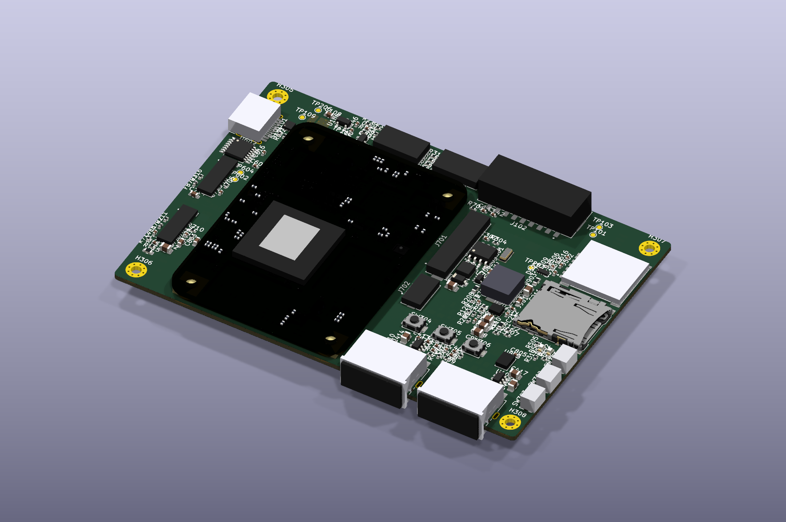
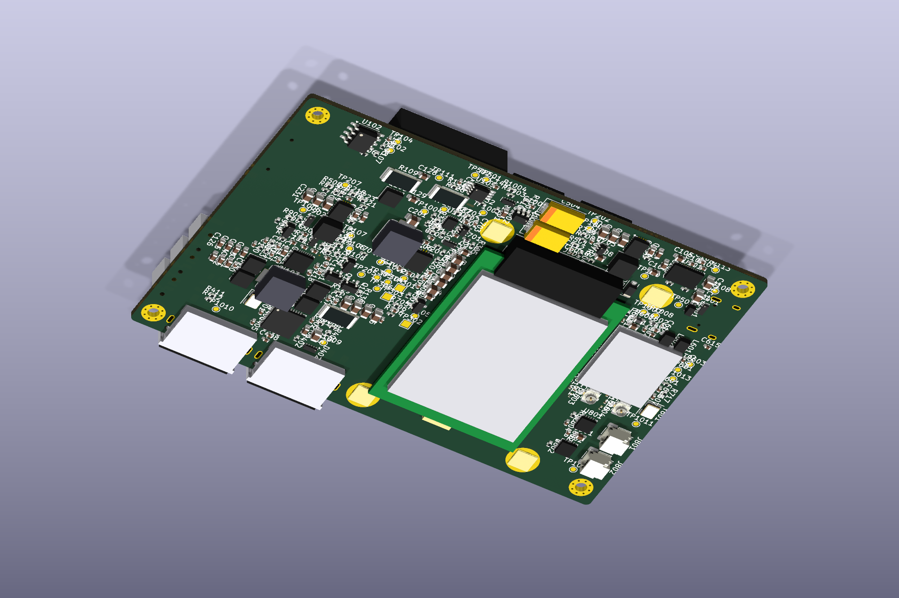
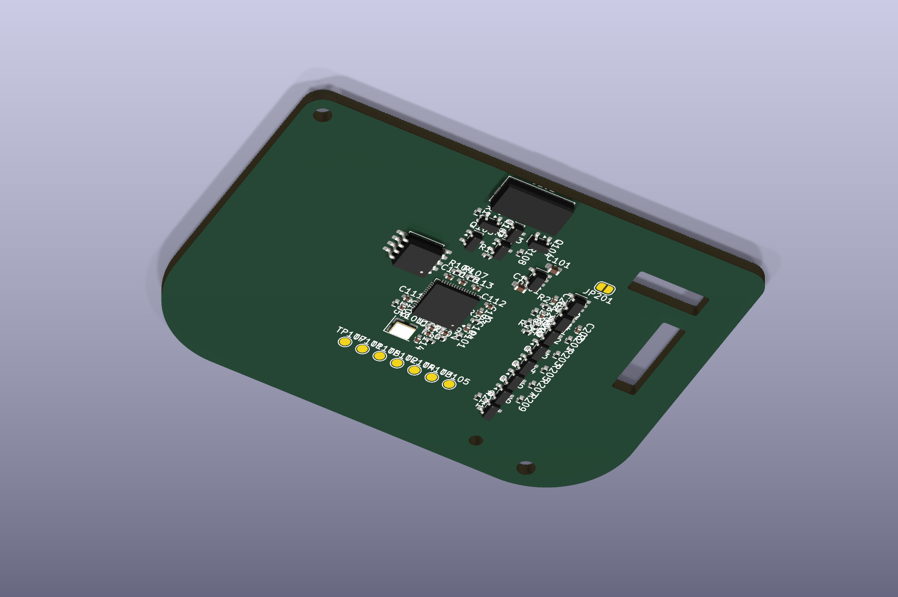
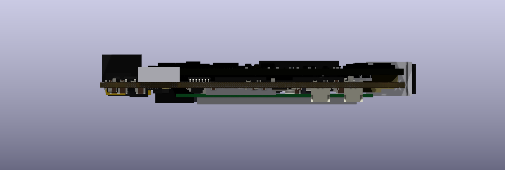

# Checkpoint 3: placement, mechanical, 3D renders, height check

Status, 2026-10-17 (revised after your review): **both boards are placed.** Every part is on the board, nothing overlaps and nothing shorts. Routing has not started (checkpoint 4).

After your answers I added the two cameras. I also went through the placement again, and it was not good enough: the switching regulators had been placed part by part, so several inductors sat 5–10 mm from their switch pins, and some input capacitors had been put next to a different IC on the same net. **Each switching power stage is now laid out as one group, following its TI datasheet layout example (§1b).** Every UNVERIFIED item from the first version of this report is now closed (§6).

| | Board A, CM5 carrier | Board B, Q20 keyboard |
|---|---|---|
| Size | **95.0 × 65.0 mm**, 1 mm corners, two USB-A cutouts | **74.0 × 53.1 mm**, BBQ20KBD outline (r 3.1 / r 14 corners, 2 slots, Ø2 hole) |
| Stack-up | 6 layers, 1.2 mm, JLC06121H-3313A, ENIG | 2 layers, 2.0 mm (as BBQ20KBD), ENIG |
| Parts | 430 footprints, both sides: 135 placed by hand (connectors, ICs, six power stages, modem decoupling), 295 by the placer next to the pin they serve | 67 footprints; keyboard connector on the front, the rest on the back |
| Height | **10.65 mm** component stack (9.32 mm without the battery connector, see §4) | 4.96 mm (0.8 front + 2.0 board + 2.16 back) |
| Placement DRC | 0 overlaps, 0 shorts, 0 clearance problems between parts | same |

Files:
- `hw/board_a/cm5_carrier.kicad_pcb`, `hw/board_b/q20_keyboard.kicad_pcb`, generated by `gen/pcb_a.py` and `gen/pcb_b.py`.
- Footprints from `gen/footprints.py`.
- Renders and plots in `img/`.

---

## 1. What changed since checkpoint 2

| # | Change | Why |
|---|---|---|
| D11 | **Battery connector: Molex 505578-0971**, the right-angle version of the same Micro-Lock Plus 2.0 family (LCSC C17389413, JLC stock 50). Same mate (505570-0901), same pins, same 12 A. | 505575-0971 is the *vertical* version: 5.8 mm body, plus the plug housing and wires on top. The right-angle one is 5.9 mm in total with the plug in. The Molex drawing was not on JLC; LCSC hosts it, and the footprint is drawn from it. |
| D12 | **Power / volume buttons moved from the top edge to the right edge** (next to SD and SIM). | The battery sits beyond the top edge, the only edge without an external connector, so buttons there could not be reached. |
| D13 | **CM5 fixing: 4 × M2.5 × 1.5 mm SMT standoffs** (YIYUAN SMTSOM2.515BTR, C5221850, stock 3.5 k) at Radxa's hole positions. They replace the plain holes. | 1.5 mm equals the DF40 stack. Nothing but a 0.33 mm shank pokes out below, so the M.2 modem can sit under the module corners. Nuts would collide with it. |
| D14 | **M.2 standoff: Sinhoo SMTSO2010CTJ** (M2, 1.0 mm, C2916319, stock 7.8 k). | The socket holds the card 1.25 ± 0.10 mm up, but no 1.25 mm SMT nut is stocked. At 1.0 mm the screw pulls the card end 0.25 mm down; 1.5 mm would raise the stack 0.25 mm. |
| D15 | **MAX17055 footprint from the LCSC/EasyEDA land** (TDFN-10, **0.4 mm pitch**, not 0.5 mm as the old name said). | Maxim's land 90-100007 and outline 21-100013 are still unreachable (analog.com times out over HTTP/2 and HTTP/1.1). The EasyEDA land agrees with the datasheet pin-out figure, but it stays **UNVERIFIED**. |
| D16 | **CSD17577Q3A gets its own footprint.** | KiCad's NexFET footprint merges drain pads 5–8 into one pad "5", leaving schematic pins 6–9 without pads. The new one follows TI §7.2. Re-reading the drawing also caught a wrong value in my notes: the drain fingers lie *beyond* the 1.775 mm drain pad (out to x = 1.85), not inside it. |
| D17 | **USB-A pads end 0.3 mm short of the cutout edge.** | HOAUC's pads run to the cutout edge, but JLC needs copper ≥ 0.3 mm from a routed edge. The solder joint is formed at the tail tip, away from the edge. |
| D18 | **Mic on the top side**, acoustic port through the board to the back. | The bottom-port mic was under the CM5 when placed on the bottom. |
| D19 | **Board B: 2 layers, 2.0 mm**, as BBQ20KBD. | Keeps the keyboard height of the reference design. |
| D20 | **Keyboard FFC on Board A centred on the device axis** (x = 47). | Board B's FFC is centred, so the cable runs straight (offset 0.5 mm). |

## 1b. Changes after your checkpoint 3 review

| # | Change | Why / source |
|---|---|---|
| D21 | **Rear camera: Radxa Camera 13M 214** on CAM-A J704 (Hirose FH35C-31S, 4 lanes, CSI1 = DCPHY0). Sony IMX214, 13.1 MP (4208 × 3120), autofocus, F2.0, FOV 78.4° diagonal, HDR. Cable: Radxa 31-pin 0.3 mm, 150 mm, opposite-side contacts. | Product brief (`research/dl/cameras/`), docs.radxa.com/en/accessories/camera/camera-13m-214. Radxa ships a CM5 IO-board overlay for it (`radxa-cm5-io-radxa-camera-13m-214.dts`), and Rockchip's RK3588 IQ tuning file `imx214_RADXA-CAMERA-13M` exists. J704's wiring matches that overlay pin for pin: I2C8_M2, MCLK GPIO1_B6, PDN GPIO1_A7, RESET GPIO1_B3. |
| D22 | **Front camera: Radxa Camera 8M 219** on CAM-B J705. Sony IMX219, 8.08 MP (3280 × 2464), F2.5, FOV 74° diagonal, 2 lanes at up to 912 Mbps per lane. | docs.radxa.com/en/accessories/camera/camera-8m-219 and the CM5 page docs.radxa.com/en/som/cm/cm5/accessories/camera_8m. It has an RK3588 IQ file (`imx219_RADXA-CAMERA-8M`) and a CM5 IO overlay (`radxa-cm5-io-radxa-camera-8m.dts`). |
| D23 | **CAM-B connector: Hirose FH35C-31S** (same as CAM-A) instead of the 15-pin 1.0 mm FFC. Front camera wired like Radxa's 8M overlay: CSI0 2-lane, I2C7_M2 at 3.3 V, PDN GPIO1_B2, RESET GPIO1_A6, MCLK GPIO1_B7 (0 Ω, for modules without an oscillator). Cable: Radxa 31-pin 0.3 mm → 15-pin 1.0 mm, same side (the ROCK 5A/5B/5C cable). | Radxa sells the 8M 219 with that cable for its RK3588 boards, so both cameras are off-the-shelf with a supported cable. The 15P connector (BXCONN 15P) is gone from the BOM. |
| D24 | **MAX17055 footprint verified** against the Maxim drawings you supplied: land pattern 90-100007 rev B, outline 21-100013 rev C. TDFN-10 2 × 2.5, 0.4 mm pitch, pads 0.2 × 0.65 at y ±1.225, exposed pad 1.4 × 1.3. | Your files, copied to `research/dl/maxim/`. |
| D25 | **USB-C common-mode choke: Murata DLW21SN900SQ2L** (C97856, JLC stock 60 k) instead of the Sunlord part. | Murata's datasheet shows the equivalent circuit: windings 1–2 and 4–3, phase dots on 1 and 4. That settles which pads form a winding, which the Sunlord drawing did not. |
| D26 | **Switching power stages laid out as groups** (`gen/stages.py`), each from its datasheet layout example: BQ25713 charger (TI SLUSD83C Fig. 12-1), TPS61088 (ZHCSDP8A Fig. 19), TPS61089 (SLVSD38C Fig. 11-1), 2 × TPS63020 (SLVS916I Fig. 31), TPS61169 (SNVSA40B Fig. 7-15). Inductor pads now sit 1.6–4.3 mm from the switch pins (pad centres), down from 5–10 mm. Input and output capacitors close each high-current loop at the IC. Feedback dividers sit next to the FB pins, at 2–4 mm spanning length. | Before, the inductor of the LTE regulator was on the wrong side of its IC and the charger's input capacitors were 60 mm away, next to the USB-PD chip. See §2.6. |
| D27 | **Modem decoupling per Quectel EM060K HD §3.5.2.** The 1 µF / 100 nF / 33 pF / 10 pF array for each VCC pin group sits 1–2 mm behind the pins, in two openings in the M.2 courtyard under the module edge (0402 = 0.55 mm under a 1.25 mm gap). The two 220 µF capacitors sit beside the LTE regulator, about 11–17 mm away along a ≥ 2.5 mm VCC pour. The rest of the module area stays clear for the thermal pad Quectel recommends (HD §6.7). | The socket ends are taken by the CM5 standoffs. Behind the socket's far pin row, the module covers everything. |
| D28 | **Wi-Fi module turned 90°.** Its buck pins (25–29) now face the free strip above it, with the two buck inductors right there (before, one was on the other side of the board). Antennas go down to the u.FL pair; PCIe faces the CM5 connector. | The M.2 module leaves only 1 mm beside the old pin edge. |
| D29 | **PD EEPROM moved under the SIM**, on the I2C bus between the PD controller and the charger. | It was taking the space the LTE regulator needs. |
| D30 | **Placer anchors passives within their schematic group** (`hw/board_*/groups.json`, written by the schematic build). | The old rule took "an IC on the same sheet and the same net", which tied the charger's CHG_IN capacitors to the USB-PD controller. |
| D31 | **Parts without a KiCad 3D model get a datasheet-size box** (`gen/bodies.py`): SRP7028A inductors, USB-C, side buttons, mic, the WQFN/TQFN ICs. | They were missing from the renders. The heights were already right. |

---

## 2. Board A

### 2.1 How the board sits in the device



- **CM5 on the top face** (the face toward the display), unrotated: connector A to the right, B to the left, C toward the top edge.
  - The 41 × 56 mm module outline is the courtyard of J301, so nothing else is placed under it.
  - **Heat-spreader zone** on User.2 (41 × 56, module top 4.57 mm).
- **M.2 LTE (EM060K-GL) on the bottom face, under the CM5**, as you decided at checkpoint 1.
  - The socket sits under connector C, and the 30 × 42 module runs toward the bottom edge.
- **Battery beside the board, beyond the top edge.**
  - Outline 85 × 65 × 8 on User.1, 3 mm gap.
  - The top edge is the only edge without an external connector, so it is the battery side.
- In the device, the board sits behind the display with the USB-A edge at the top of the device; the battery sits behind the keyboard. Board A's top edge therefore faces the keyboard: the keyboard FFC leaves there, and so does the battery cable.

### 2.2 What sets the size (95 × 65, the brief's maximum)

| Width (95 mm) | Height (65 mm) |
|---|---|
| left strip 12 mm: USB-C (9.5 deep) and the two camera FPCs | CM5 56 mm |
| + CM5 41 mm | + 8.5 mm strip above it for the keyboard / digitizer FFCs |
| + 24 mm column: display / touch connectors, battery connector (22 mm wide), USB-A pair | |
| + 18 mm right edge: microSD body 16.2 deep, SIM 15 | |

The bottom side is about 57 % full (courtyard boxes) and the top about 83 % (the CM5 alone is 2,300 mm²). There is no spare 5 mm in either direction.

### 2.3 Edge connectors (board coordinates: origin top-left, x right, y down, mm)

| Edge | Part | Position | Note |
|---|---|---|---|
| Left | USB-C J101 (HRO TYPE-C-31-M-12) | y 8.0–17.0 | Shell front 0.46 mm past the edge, as HRO's "PCB EDGE" line |
| Right | nano-SIM J502 (GCT SIM8066) | y 8.6–20.9 | Card slot 0.6 mm inside the edge (the GND tabs need 0.3 mm to the edge) |
| Right | microSD J901 (Hirose DM3AT) | y 23.1–36.9 | Body front 0.4 mm inside the edge |
| Right | POWER / VOL+ / VOL− (Alps SKRTLAE010) | y 41.5 / 48.0 / 54.5 | Side-push actuators at the edge |
| Bottom | USB-A J401 / J402 (HOAUC HYCW236, mid-mount) | centres x 62.3 / 80.5 | 14.9 → 14.4 mm cutouts. The flange front is 1.5 mm and the mouth front 3.0 mm past the edge (HOAUC drawing; this table said 2.4 mm until D115): the enclosure wall goes there. |
| Top | battery J102 (Molex 505578-0971) | x 54–76 | Mating face 0.4 mm inside the edge, toward the battery |
| Corners | 4 × M2 holes | (3.5, 3.5), (3.5, 61.5), (91.5, 3.5), (92.0, 61.5) | |

Status LED D302 and LTE LED D501 sit next to the power button (light pipe needed). Reset / Maskrom / Recovery (TS-1088, top push) are inboard at y = 47.

### 2.4 FPC / FFC connectors: positions, ribbon exits, lengths

All are on the top face and inboard; the ribbon exits are drawn on User.3. Each "entry" column shows the side the cable enters from.

| Connector | Position (pads) | Ribbon enters from | On-board run to the edge | Cable |
|---|---|---|---|---|
| J701 display 30P (HDGC 0520-HX-30PWB, 2.0 mm) | (55.0, 23.0) | +x (right edge) | 35 mm, passing over the SIM / microSD | Panel 30P tail ≈ 43–47 mm past the panel edge* |
| J702 touch 8P (XUNPU, 1.5 mm) | (55.0, 38.5) | +x | 35 mm | CTP tail ≈ 58–63 mm*: about 16 mm extra, take it up in a gentle loop |
| J705 CAM-B (front) 31P 0.3 mm (Hirose FH35C) | (3.0, 30.0) | −x (left edge) | 2.8 mm | Radxa 31p 0.3 mm → 15p 1.0 mm, same side (Camera 8M 219) |
| J704 CAM-A (rear) 31P 0.3 mm (Hirose FH35C) | (3.0, 46.5) | −x | 2.8 mm | Radxa 31p 0.3 mm, opposite side, 150 mm (Camera 13M 214) |
| J1001 keyboard 12P (BXCONN) | (47.0, 7.0) | −y (top edge) | 1.2 mm | To Board B, see §3 |
| J703 digitizer 12P (reserved) | (33.0, 7.0) | −y | 1.2 mm | Future EMR digitizer |

\* Scaled from the DisplayModule outline drawing. Its dimension text is a low-resolution raster and can't be read.

**Display:**
- The display ribbon fits if the panel is mounted with its FPC edge over the board's right edge, i.e. the device's left side. A 720×720 panel can be rotated in software.
- The 30P tail then needs about 35 mm on the board + 3 mm in the connector + about 4 mm for the 180° turn round the panel edge (≥ 1 mm radius), roughly what it has. **This needs the full DisplayModule outline drawing** (your action from checkpoint 1) or a measurement on a sample before the enclosure is fixed.

**Cameras:** both camera connectors face the device's right side (board left edge), near the top of the device, where camera modules normally go. Radxa's standard cables are 150 mm, which covers any position in a device this size. The rear module is 32 × 32 mm. It is 9.5 mm deep: 6.38 mm lens + 1.6 mm board + parts under 1.5 mm (Radxa brief p. 4). So it goes beside the board, not over it.

### 2.5 Bottom side



- **M.2 socket and module.** The module rests on the 1.0 mm standoff at its 42 mm end. The module area is kept free for the thermal pad, except the two decoupling openings behind the VCC pins (D27).
- **Wi-Fi.**
  - The AP6275P is bottom-left, under PCIe connector B, turned so its buck pins face up and its antenna pins face down (D28).
  - The two buck inductors sit right above pins 25–29.
  - The u.FL connectors sit under WL_ANT0 / WL_ANT1, 4 mm of 50 Ω line each.
  - The TXS0104E and the 37.4 MHz crystal are next to it.
- **USB-C power path.** The TPS25751D is under the USB-C.
- **Battery path** at the battery connector (TI rule 5): RSR, BATFET and the 4 mΩ gauge shunt (Kelvin net-tie on its GND pad), with the MAX17055 next to the shunt.
- **Charger** (bottom, under the touch / SD area): the full BQ25713 power stage as one group (§2.6).
- **CM5 supply** (TPS61088): its output capacitors sit directly under the CM5 VIN pins of connector A.
- **AUX 3.3 V** (second TPS63020): between the CM5 supply and the SD card.
- **LTE supply** (TPS63020): above the socket, output toward VCC pins 70–74. The two 220 µF capacitors are stacked beside it.
- **USB hub** next to the USB-A ports.
- **Audio.** Amplifiers and speaker sockets are bottom-left.
- **Top side, right of the display connector:** the 5 V boost (TPS61089, output toward the USB-A power switches) and the backlight boost.

Plots with every reference (`tools/placement_plot.py`): `img/board_a_placement_top.png` and `img/board_a_placement_bottom.png`. The bottom plot is drawn see-through from the top, not mirrored, so the two plots line up.

### 2.6 Switching power stages

| Stage | Side | Layout (from the datasheet example) | Inductor pad → switch pin |
|---|---|---|---|
| BQ25713 charger, 4 × CSD17577Q3A, 2.2 µH SRP7028A | bottom | Q1 / Q2 half bridge and Q3 / Q4 half bridge face L1 with their SW columns. RAC and 4 × 10 µF CBUS sit beside Q1 / Q2, with 10 nF + 1 nF right at Q1's drain / Q2's source (loop 1). 7 × 10 µF + 100 nF VSYS sit beside Q3 / Q4, with a VSYS bus between two rows (loop 2). The controller sits under L1 with its gate-drive edge toward the FETs; the bootstrap capacitors are 1.9–2.7 mm from BTST1/2. | 2.6 mm (both) |
| TPS61088 → CM5_VIN | bottom | L on the SW pins; 3 × 22 µF along VOUT with 1 µF from VOUT to GND pin 12; FB divider and compensation left of the IC. | 4.3 mm |
| TPS61089 → 5 V | top | L straight on SW (pin 11); 1 µF + 3 × 22 µF across VOUT / GND right under the IC; FB divider on FB. | 3.0 mm |
| TPS63020 → LTE / AUX | bottom | L on the L1 / L2 end; 2 × 10 µF at VIN; 3 × 22 µF at VOUT, the first one with its GND pad on GND pin 2. | 3.3 mm |
| TPS61169 backlight | top | L and Schottky on SW, 1 µF output capacitor back to the IC ground, RSET on FB. | 1.6 mm |
| AP6275P internal bucks | bottom | 2.2 µH inductors over pins 25–29 | 3.6–3.7 mm |

`docs/checkpoint3/placement_check_board_a.txt` (`tools/placement_check.py`) lists these distances, every decoupling capacitor more than 4 mm from a pin on its rail, and the spanning length of every feedback, compensation, gate-drive, bootstrap and sense net.

What remains above 4 mm is there on purpose:
- the second and third bulk capacitor of each output row (4.6–7 mm);
- the two modem 220 µF capacitors (D27);
- the backlight output capacitor, which is measured to the display connector;
- the 10 µF bulk capacitors on the CM5's own 1.8 V / 3.3 V outputs (7–8 mm from connector A).

The charge-current sense pair (BAT_SRP / BAT_P) runs about 30 mm from the RSR (at the battery connector, rule 5) to the filter at the charger IC. TI rule 7 asks for exactly that: a Kelvin differential pair from the resistor pads. It is routed as such at checkpoint 4.

---

## 3. Board B



- **Outline, slots, holes and the keyboard connector position are copied from BBQ20KBD's `bbq20_keyboard.kicad_pcb`.**
  - J201 (Hirose BM20B) is the only front-side part, at (12.0, 22.2), rotated 90°.
  - Checked pad by pad: pin 1 lands at (10.91, 26.0), against BBQ20KBD's (10.9, 26.0).
- **The back side uses BBQ20KBD's positions:** RP2040, flash, crystal, the three LDOs, the column of 1.8 V trackpad shifters, and the SWD / BOOT / RUN / UART test-pad row. The pads are respaced 2.54 → 2.8 mm so their courtyards clear.
- **The carrier FFC J101 replaces BBQ20KBD's USB-C at the top edge**, cable leaving the top edge. The five BSS138 isolators (D9) sit around it.
- **Carrier cable:**

  | Property | Value |
  |---|---|
  | Type | 12-pin, 0.5 mm FFC, **type B (contacts on opposite sides)** |
  | Starting length | **50 mm**, to be confirmed in your enclosure CAD |
  | Route | straight, pin 1 to pin 1 |
  | Connectors | BXCONN FC-05A12P11H20 (bottom contact) on both boards |

  Why type B: on Board A the cable lies on the front-facing top side, contacts toward the back. On Board B it lies on the back-facing back side, contacts toward the front. A cable bent into an S without folding over needs contacts on opposite faces; if you fold it back on itself 180°, use type A instead. Both pin 1s sit on the same side of the device centreline, so conductor order is preserved.

---

## 4. Height check



Heights come from the datasheet drawings, or from the KiCad STEP model where one exists and no drawing says otherwise (`tools/heights.py`).

**The five tallest parts on Board A:**

| # | Part | Height | Side | Source |
|---|---|---|---|---|
| 1 | J102 battery connector, Molex 505578 | **5.90** | top | Molex drawing 5055780001 |
| 2 | CM5 module on the DF40 stack | **4.57** (4.55 measured in the STEP) | top | Radxa STEP |
| 3 | USB-A J401 / J402 | **4.33** above, 1.69 below the bottom surface | top, sunk into the cutout | HOAUC drawing |
| 4 | M.2 socket + EM060K-GL module | **3.55** | bottom | HOAUC drawing + Quectel fig. 35 |
| 5 | Side buttons SKRTLAE010 | **3.30** | top | Alps drawing |

Next tallest:
- USB-C 3.26 (top).
- SRP7028A inductors 3.0 max (bottom).
- JST-SH speaker sockets 2.96 (bottom).
- Everything else ≤ 2.0.

**Stack: 5.90 + 1.20 + 3.55 = 10.65 mm. Without J102: 4.57 + 1.20 + 3.55 = 9.32 mm**, the figure you accepted at checkpoint 1/2.

The battery connector is the one part above the CM5, by 1.33 mm. It only sets the device thickness if the display back sits directly on the CM5. The CM5 needs a heat spreader to the display frame anyway (brief). A typical stack of 0.5 mm thermal pad + 1.0 mm aluminium puts the display back at about 6.1 mm, above J102. If that holds, the effective stack is set by the CM5 + spreader, not by J102.

I found no lower locking connector rated for 12 A and stocked with a datasheet. Pico-EZmate, for example, is 1.5 A per pin. Soldered battery leads would remove J102 but break the brief's "locking connector, unplugs easily".

**Board B:**
- 0.80 mm on the front (BM20B, under the keyboard).
- 2.0 mm board.
- 2.16 mm on the back (SOIC-8 flash).
- Total **4.96 mm**.

---

## 5. Checks done at this checkpoint

- **CM5 3D model alignment.** The Radxa STEP was exported alone (`kicad-cli pcb export stl --component-filter J301`):
  - Module outline: x 12.06–53.06, y 8.74–64.74, matching the 41 × 56 courtyard to 0.06 mm.
  - Plugs for connectors A and B: model x 48–51 / 14–17 against our pads 47.6–51.5 / 13.6–17.4. Plug C: model x 20–42, y 10–14 against our pads 22.6–42.8, 10.9–14.6.
  - Mounting holes coincide with our standoffs (render: 16.0 / 49.0 mm, 12.7 / 60.75 mm).
- **CM5 underside.**
  - The model has parts on the module's bottom reaching 0.4–1.0 mm above the carrier, so nothing may sit under the module on the top side. The J301 courtyard enforces this.
  - The only intrusion is the M.2 standoff shank (0.33 mm). The lowest model point over it is 0.92 mm higher, so it clears.
- **Footprints.**
  - 23 project footprints. Each land was re-read against its drawing at this checkpoint, except the DF40, whose positions were checked against the Radxa STEP (above). The MAX17055 land now comes from Maxim's own drawing (D24).
  - `tools/fpcheck.py`: every schematic pin has a pad, and every numbered pad has a pin (both boards).
  - After the camera and choke changes: ERC 0 / 0 on both boards and 0 netlist mismatches (Board A 524 nets / 430 parts). The CM5 pin map has been regenerated (`docs/checkpoint2/cm5_pin_map.csv`, 123 pins used).
- **Placement quality** (`tools/placement_check.py`, reports in `placement_check_board_a.txt` / `_b.txt`): see §2.6. On Board B the only decoupling capacitor beyond 4 mm is the RP2040 DVDD 1 µF, at 4.3 mm (BBQ20KBD position).
- **Placement DRC** (`kicad-cli pcb drc`, KiCad default rules for now):
  - **0 courtyard overlaps, 0 shorts, 0 clearance problems between different parts.**
  - What remains is expected, and fixed at checkpoint 4 with JLC's 6-layer rules:

    | Group | Items |
    |---|---|
    | Pad gaps inside fine-pitch footprints | 0.125–0.18 mm (JLC minimum 0.09) |
    | 0.2 mm vias inside TI QFN footprints | (JLC minimum 0.15–0.2) |
    | Edge clearance | against KiCad's default 0.5 mm (JLC 0.3) |
    | Alps guide-boss holes | 0.1 mm from their pads, as in Alps' own land pattern. Checked against JLC's hole rule at checkpoint 4. |
    | By design, inside the CM5 courtyard | the four CM5 standoffs, the M.2 standoff and the M.2 locating holes, to be excluded with this justification |

- **Placement is reproducible.** Two runs with different Python hash seeds give identical boards.
- **Height:** unchanged at 10.65 mm. The SRP7028A inductors are 3.0 mm and lie on both sides: two on the bottom, the 5 V one on the top.
- **BOM, live JLC check (5 boards)** (`bom_board_a.csv`, `bom_board_b.csv`), re-run after the changes:
  - Board A: 156 lines, 379 parts, **0 problems**. All in stock: the battery connector (stock 50), the CM5 standoffs, the M.2 standoff, the Murata choke and two FH35C-31S connectors.
  - Board B: 17 lines, 57 parts, 0 problems.

---

## 6. UNVERIFIED / open items

| Item | State |
|---|---|
| MAX17055 TDFN-10 land | **Verified** against Maxim 90-100007 rev B / 21-100013 rev C (D24) |
| USB-C common-mode choke winding pairing | **Resolved**: Murata DLW21SN, windings from Murata's equivalent circuit (D25) |
| microSD card detect | Verified (Hirose DM3AT p.3: open without a card) |
| SIM card detect | Verified (GCT: normally closed) |
| Display FPC tail lengths | Still scaled from the drawing (±10 %). You confirmed the panel orientation; the exact tail length needs DisplayModule's full outline drawing or a sample. |
| Software | Radxa's CM5 IO overlays fit both cameras as wired, unchanged: `radxa-cm5-io-radxa-camera-13m-214` (CSI1 = DCPHY0, I2C8_M2, facing "back") and `radxa-cm5-io-radxa-camera-8m` (CSI0 = DPHY0, I2C7_M2, PDN GPIO1_B2, facing "front"). They claim different PHYs (exclusive `csi2_dcphy0` / `csi2_dphy0`), so both can be enabled at once. |

There are no UNVERIFIED items left in the schematics, footprints or BOMs.

---

## 7. Your answers (2026-10-17)

1. Battery connector height (10.65 mm stack): accepted.
2. Display FPC toward the device's left side (board right edge): yes, as placed.
3. Cameras: Radxa Camera 13M 214 at the rear and Radxa Camera 8M 219 at the front (D21–D23).
4. Maxim drawings: supplied, footprint verified (D24).
5. Quality check, then checkpoint 4: done (§1b, §2.6); routing follows.

---

## 8. Regenerate

```
python3 gen/footprints.py                 # project footprints, 3D boxes, gen/data/fp_meta.json
python3 -I gen/build_a.py                 # Board A schematic, ERC, netlist, groups.json
python3 -I gen/build_b.py                 # Board B schematic, ERC, netlist, groups.json
python3 tools/fpcheck.py hw/board_a hw/board_a/cm5_carrier.net
python3 gen/pcb_a.py                      # Board A PCB (placement; power stages in gen/stages.py)
python3 gen/pcb_b.py                      # Board B PCB (placement)
python3 tools/heights.py hw/board_a/cm5_carrier.kicad_pcb
python3 tools/placement_check.py hw/board_a/cm5_carrier.kicad_pcb > docs/checkpoint3/placement_check_board_a.txt
python3 tools/placement_plot.py hw/board_a/cm5_carrier.kicad_pcb B docs/checkpoint3/img/board_a_placement_bottom.png
sh tools/renders.sh docs/checkpoint3/img  # 3D renders of both boards
python3 -I tools/bom.py hw/board_a cm5_carrier docs/checkpoint3/bom_board_a.csv   # BOM + live JLC check
```

**Note on the project folder.** One of my edit scripts emptied `gen/footprints.py` (a file was opened for writing before it was read). I rebuilt it from this session's edits. The regenerated library is byte-identical to the output from before the accident, apart from the two intended changes. The project is not under version control; I suggest `git init` so a slip like that is a one-command undo.
